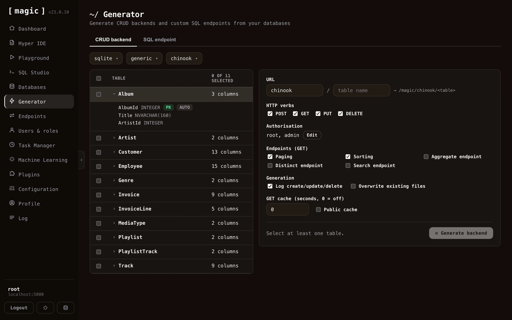
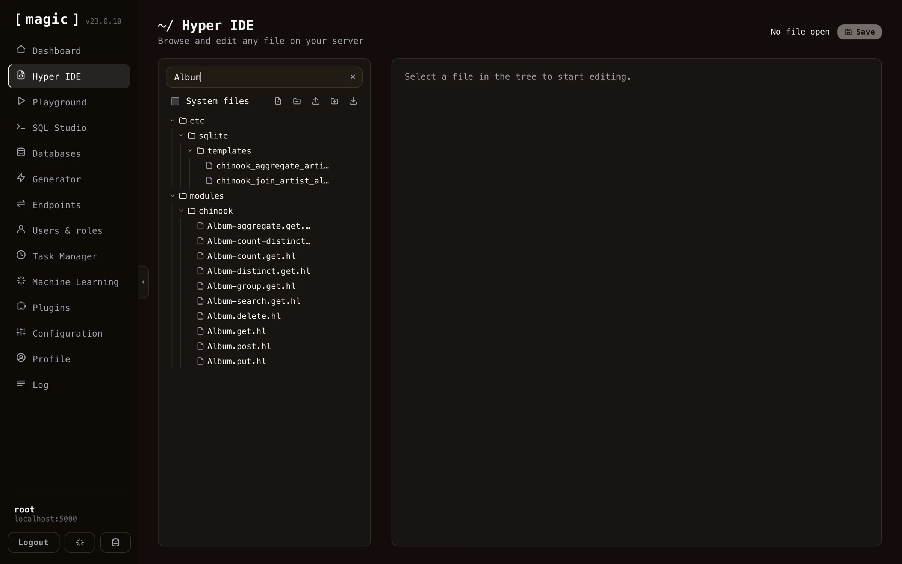
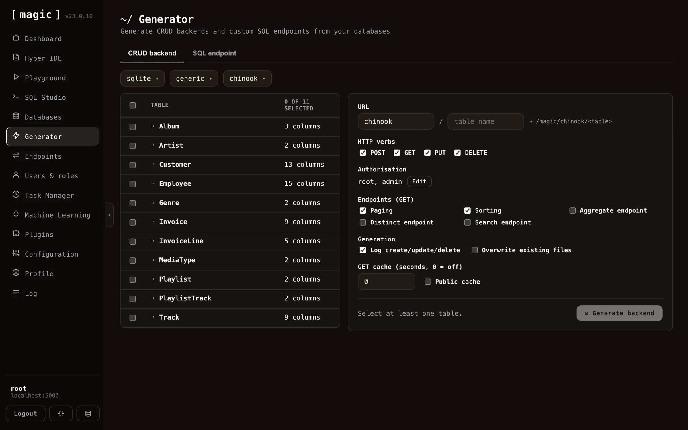

The fastest way to use the generator is through the _"API Wizard"_ card on the dashboard's landing page. This starts a guided version of the Endpoint Generator, walking you through three steps - _choose data_, _generate_, and _done_. The guided flow preselects every table in your database, since that is almost always what you want when creating an API from scratch, and if you haven't got a database of your own yet, it points you to the [databases](/dashboard/databases/) component to create or connect one first.

When generation is done, the guided flow tells you how many endpoints it created and where they live, and links you directly to the [endpoints](/dashboard/endpoints/) component - filtered to your new module such that you can try your API immediately - and to [users and roles](/dashboard/users-roles/), where you control who is allowed to invoke it.

## How to use the endpoint generator

To use the endpoint generator component you must first select a database. Then you can optionally configure the CRUD process for individual tables, such as configuring what URL your CRUD API should use, whether or not to turn on caching of HTTP GET endpoints, what authorisation requirements each endpoint should have, etc.

Notice, if you deselect all tables and select only one table, you get a lot more options to choose from. This is useful if you need additional control over how your API endpoints are generated, and what results the endpoint generator should give you.

The Endpoint Generator creates 5 HTTP endpoints by default for each table. One endpoint for each CRUD operation, and a 5th endpoint to count items. If your table does not have a primary key, it will not be able to generate delete or update endpoints. If your primary key has a default value, it will not generate endpoint code requiring a primary key value for its create endpoints. In general, the endpoint generator tries to intelligently choose defaults for your tables as it generates your backend. However, it is not always able to choose correctly for you, so you might want to sanity check its result after you've generated your backend.

## Additional endpoint types

In addition to the standard CRUD endpoints, the generator can optionally create a few extra query endpoints for a table. You enable these per table before you generate your backend.

* **Aggregate** - Creates an endpoint that returns the minimum, maximum, average, sum, or count for a column you specify, grouped by another column. The grouping column is mandatory, so the endpoint always returns your aggregate value per group. This lets you produce totals and statistics directly from your database, without writing any SQL yourself.
* **Distinct** - Creates an endpoint that returns the unique, distinct values from a column, allowing you to list every value that occurs in a column without duplicates.
* **Search** - Creates an endpoint that performs a _"keyword density search"_ across your table, ranking each row by how many of your keywords it matches, and sorting the result by _"most matches"_ first. This gives you a simple relevance-ranked, full-text style search endpoint out of the box. Keyword density search is actually a good substitute for RAG and VSS - it requires no embeddings, no vector database, and no AI inference, yet often yields surprisingly relevant results, making it a great low-cost alternative when you need search but don't need semantic understanding.

Below is how the result looks like in [Hyper IDE](/dashboard/hyper-ide/) after having generated all endpoint types for a table - one Hyperlambda file per endpoint, including the count, distinct, aggregate, group, and search endpoints.

## Endpoint generator settings

Once you have selected a database and a table, you can override individual settings for how Magic should create CRUD endpoints wrapping your specified table. You can also turn on or off specific columns, preventing Magic from accepting values for these columns, also for individual CRUD verbs. If you have a read only type of column for instance, that should only be set during _"create"_ invocations, you can easily remove that field from your _"update"_ endpoint, making sure Magic does not accept new values to that column when its update endpoint is invoked.

You can also override what URLs your endpoints should use, what authorisation requirements your endpoints should have, in addition to a lot of other settings, such as turning on logging, caching, etc.

## Endpoint generator settings complete list

Below is a complete list of what settings you can apply when generating your endpoints. Notice, some of these settings are only possible to apply if you've selected only _one_ table.

* What fields each CRUD endpoint accepts
* Authorisation requirements for each CRUD endpoint, allowing you to declare which role a user must have to be able to invoke your endpoints
* Primary and secondary URL, allowing you to tell the backend generator what URLs to generate for a particular table
* Paging and sorting, allowing you to turn on or off paging of data and sorting of data
* Additional GET endpoints, such as aggregate, distinct, and search endpoints, giving you more ways to query your table
* Turning on or off logging when your create, update and delete endpoints are invoked
* Caching, implying HTTP cache, or the _"Cache-Control"_ HTTP header, and whether or not to turn on public cache or not, where public caching allows proxies to cache your endpoint's result. Notice, caching is _only_ applied to GET endpoints in this component
* Overwrite, which if true, will overwrite an existing endpoint. By default, the endpoint generator will _not_ overwrite existing files unless you explicitly tell it to do so

## Endpoint generator internals

The endpoint generator will actually create 5 files for you, one file for each CRUD verb, and one file to count items. These files will be Hyperlambda files, and you can see these after the process is done by using [Hyper IDE](/dashboard/hyper-ide/) and expand your _"modules"_ folder. The generated Hyperlambda will basically be wrappers around the **[data.connect]** slot, in addition to one of the following slots, depending upon which CRUD verb the file you're looking at is wrapping.

* __[data.create]__ - The Hyperlambda slot for creating new items in your database
* __[data.read]__ - The Hyperlambda slot for reading items from your database
* __[data.update]__ - The Hyperlambda slot for updating items in your database
* __[data.delete]__ - The Hyperlambda slot for deleting items from your database

## HTTP verbs

The CRUD endpoint generator creates endpoints wrapping the POST, GET, PUT, and DELETE verbs, while the SQL and Sandbox API generators can additionally wrap PATCH, and the Search endpoint generator wraps GET or POST.

* POST - Typically used for creating or inserting new items
* GET - Typically used for retrieving or counting records
* PUT - Typically used for updating values in your database
* PATCH - Alternative to PUT with similar semantics, typically when adding new fields (SQL and Sandbox API generators)
* DELETE - Typically used when deleting records in your database.
