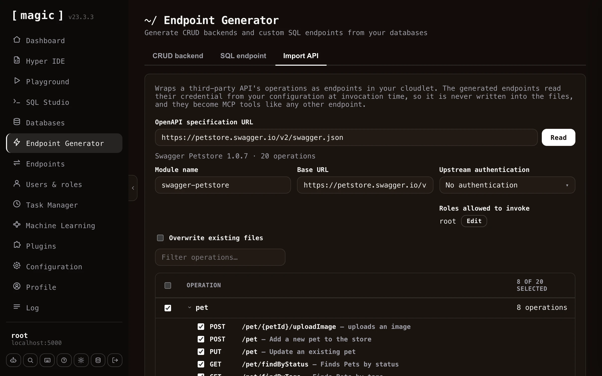

The fifth tab in the Endpoint Generator, _"Import API"_, works the other way around from the other four. Instead of generating endpoints from your own database or your own SQL, it reads an [OpenAPI](https://www.openapis.org/) specification belonging to somebody else's API - Stripe, GitHub, Slack, or any other API that publishes one - and generates Hyperlambda endpoints in your cloudlet wrapping the operations you choose.

Paste the URL of the specification and click _"Read"_. Magic fetches and parses it, then shows you every operation it found, grouped by the specification's own tags - or by the first meaningful segment of the path for specifications that don't use tags. Tick the operations you want, give the module a name, and click _"Import"_. A terminal dialog reports each endpoint as it is created, and tells you how many lines of Hyperlambda it generated when it finishes.

Both major dialects are supported - OpenAPI 3.x and the older Swagger 2.0 - in either JSON or YAML. Specifications range from a handful of operations to well over a thousand, so the filter box and the group checkboxes let you pick out just the parts of an API you actually intend to use.

## Arguments and documentation

The generated endpoints are ordinary Hyperlambda endpoints, and they are documented from the specification as they are generated. URL parameters, query parameters, and form fields each become a named, typed argument with its own comment stating the type, whether it is required, its default value, the values it accepts, and the description the specification gave it. Required arguments get a **[validators.mandatory]** invocation, so a missing argument is refused before the upstream API is ever contacted.

This matters beyond readability. Magic exposes the file level comment as an endpoint's description and each argument's comment as that argument's description, which is exactly what an [MCP](/tutorials/how-to-connect-the-mcp-server/) client reads when deciding how to call a tool. An imported API therefore arrives as a set of self describing tools an AI agent can use without any further work from you.

## Authentication towards the upstream API

Most third party APIs require a credential. You choose how the generated endpoints should authenticate - a bearer token, a custom header, a query parameter, or nothing at all - and which configuration key the credential is read from. The credential itself is never written into the generated files. It is read from your [configuration](/dashboard/configuration/) at the moment the endpoint is invoked, so your files stay safe to check into source control. The _"Set"_ button next to the configuration key lets you store the credential without leaving the component.

You also declare which of your own roles are allowed to invoke the generated endpoints, exactly as you do for CRUD endpoints, so wrapping a third party API does not implicitly expose it to everybody.

## Request bodies

Magic generates different code depending upon what the operation expects, which it reads from the specification.

* **JSON** - The endpoint takes a **[payload]** argument, and the fields the specification declares are documented above it, nested objects included.
* **Form encoded** - Each field becomes a named argument of its own, unless the specification nests objects deeply enough to require bracketed keys, in which case the endpoint keeps a single **[payload]** argument.
* **Multipart** - The endpoint accepts a file upload, and forwards it to the upstream API under the field name the specification asks for.
* **Binary** - The endpoint accepts the raw request body and passes it on untouched, which is what APIs accepting an image or a document directly expect.

By default the importer refuses to replace an endpoint that already exists, telling you which file was in the way. Tick _"Overwrite existing files"_ to re-import over an existing module, which is what you want when the upstream specification has changed and you need to regenerate.
