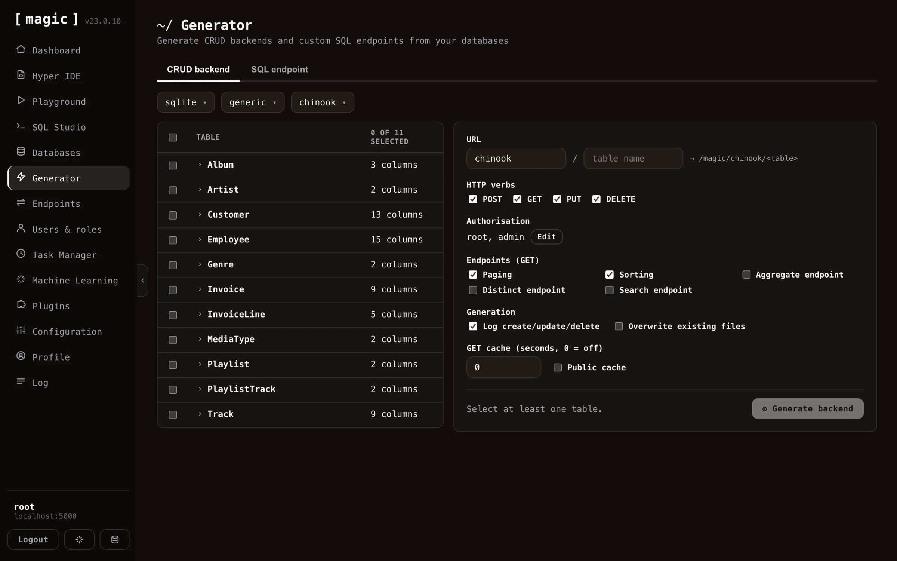

The Endpoint Generator component allows you to automatically generate an HTTP CRUD web API wrapping your database of choice. The endpoint generator component works by reading meta data from your database, which it then uses to generate Hyperlambda HTTP endpoints for you automatically.

If you use the generator on for instance the _"SQLite Sakila"_ database that you can find as a [plugin](/dashboard/plugins/), Magic will create more than 3,000 lines of Hyperlambda code for you automatically, resulting in some roughly 100 HTTP endpoints for you, providing you with all CRUD operations towards all tables in your database.

Magic can also generate an API wrapping your existing databases. If you want to use your existing databases as input, you'll have to provide Magic with a connection string that allows it to connect to your database. You can do this through the [databases](/dashboard/databases/) component.

## In this section

* [CRUD Endpoint Generator](/dashboard/endpoint-generator/crud-generator/): The fastest way to use the generator is through the "API Wizard" card on the dashboard's landing page.
* [SQL Endpoint Generator](/dashboard/endpoint-generator/sql-endpoints/): The SQL endpoint generator component allows you to generate an API endpoint wrapping an SQL statement.
* [Sandbox API Generator](/dashboard/endpoint-generator/sandbox-api/): The "Sandbox API" tab generates a single endpoint that safely executes code its own callers supply.
* [Sandbox API - Business Logic Without Raw Access](/dashboard/endpoint-generator/sandbox-business-logic/): A whitelist answers "which functions may this role call?" Often the better question is "which results may this role get?" A role that should be able to see your top customers does not need [data.conne
* [Sandbox API - Callers, Throttling and Discovery](/dashboard/endpoint-generator/sandbox-callers-and-discovery/): Two settings sit above the policy.
* [Search Endpoint](/dashboard/endpoint-generator/search-endpoint/): The "Search endpoint" tab generates a single HTTP endpoint that searches the training snippets of one machine learning type and returns the best matches.
* [Import API](/dashboard/endpoint-generator/import-api/): The fifth tab in the Endpoint Generator, "Import API", works the other way around from the other four.


