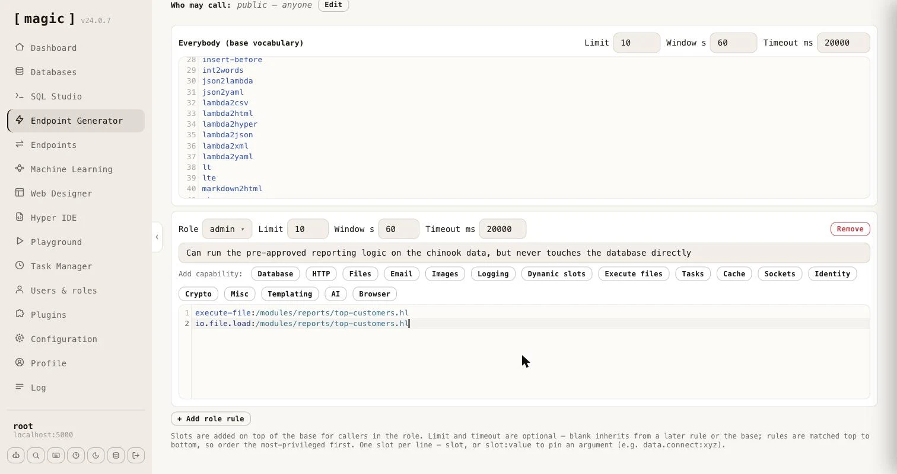
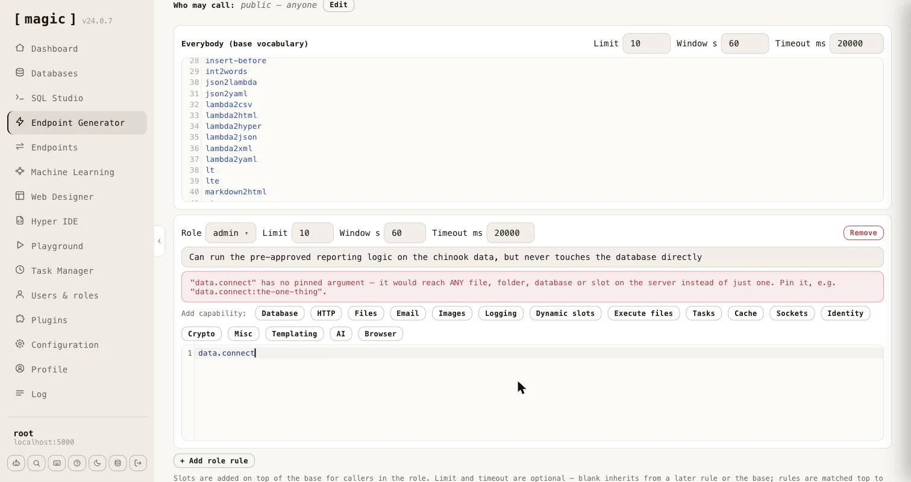

The _"Sandbox API"_ tab generates a single endpoint that safely executes code its own callers supply. Where the CRUD and SQL generators turn _your_ data and _your_ SQL into fixed endpoints, the Sandbox API publishes one endpoint that accepts Hyperlambda - or a plain-English instruction it turns into Hyperlambda - from whoever calls it, and runs it inside a whitelist that decides, function by function, what that code is allowed to do. The caller never gets more power than the roles you granted, and a function you did not grant simply does not exist as far as their code is concerned.

This is the same mechanism behind the public [Natural Language API](https://hyperlambda.dev/natural-language-api) demonstration, generalised so you can shape the vocabulary, the rate limit and the timeout per role, and mount it at a URL of your choice.

## Input - Hyperlambda, natural language, or both

The _"Input"_ selector decides what the generated endpoint accepts, and your choice is reflected both in the endpoint's arguments and in its documentation.

* **Hyperlambda** - the endpoint takes a **[hyperlambda]** argument and executes it as-is
* **Natural language** - the endpoint takes an **[instruction]** argument, sends it to the [Hyperlambda Generator](/dashboard/hyperlambda-generator/) for code, and executes the result
* **Both** - the endpoint accepts either; a non-empty **[instruction]** is used when present, otherwise the **[hyperlambda]** argument

Whichever you choose, the generator writes a matching file level comment and argument comments, so the endpoint documents itself - and, because it becomes an [MCP](/tutorials/how-to-connect-the-mcp-server/) tool, so does the tool an AI agent sees.

## How the code is checked and run

Every request goes through the same pipeline.

1. **Verify** - the code is parsed and every function it references is checked against the functions that actually exist on this server. A hallucinated function stops here, before anything runs.
2. **Execute** - the code runs inside a **[whitelist]** whose vocabulary is chosen from the caller's roles. A function that is not in the vocabulary does not resolve, and an argument that is pinned - such as a database name - must match exactly.
3. **Return** - the response always carries a **[state]** saying what happened, the **[result]** the code produced, and a **[reason]** when the runtime refused the code or it failed.

The possible states are `described` (a call that asked what is permitted), `executed`, `rejected` (a function or a pinned argument was not allowed), `unknown-slot` (a referenced function does not exist), `error` (the code threw), `timeout` (execution exceeded the configured limit), and `generator-failed` (no code came back from the generator).

## The policy - base vocabulary plus per-role grants

What the sandbox can reach is defined by a policy you build in the component, made of an _"everybody"_ base rule plus any number of per-role rules.

* **Everybody (base vocabulary)** - the language every caller gets, seeded for you with a safe set of pure, data-shaping functions (mirroring the public Natural Language API's vocabulary, minus database and HTTP access). It also carries the fallback rate limit and timeout.
* **Role rules** - each adds more functions on top of the base for callers in that role. This is how you grant your CEO's role access to one database while your HR role cannot reach it - both keep the base language, and each role's extra functions are added to it.

The vocabulary a given caller runs with is the _union_ of every rule they match, so capabilities compose. The rate limit and the timeout are resolved _independently_ - each is taken from the first matching rule, top to bottom, that declares it, so you order your rules most-privileged first and never have to calculate a maximum. The base rule sits last as the fallback for both.

Functions are written one per line. A bare name such as `data.read` grants the function; a name with a value such as `data.connect:northwind` pins its primary argument - here restricting database access to exactly the `northwind` database. File and folder functions pin their path the same way. A function that takes a _file_ takes a filename, so `io.file.load:/etc/reports/*.csv` grants loading the CSV files directly in that folder, while `io.file.load:/etc/reports/summary.csv` grants exactly one file. A folder function takes a folder, which ends with a slash, such as `io.folder.list:/etc/reports/`.

Each role rule also has a one-line description field - _"What can this role do?"_ - which you can leave empty. Everything you write there is added to the generated endpoint's file level comment as a list of roles, which is what an AI agent reads as the tool's description. It should say what the role can accomplish, in plain words, such as _"Can run the pre-approved reporting logic on the chinook data, but never touches the database directly"_.

The editor warns you when a grant is wider than you probably intended. A function whose argument is what confines it - **[data.connect]**, every file and folder function, **[execute]**, **[signal]**, **[try-signal]**, **[execute-file]** and **[io.file.execute]** - reaches _anything_ on the server when it has no pinned argument, so a bare line for any of them shows a warning telling you to pin it.

## Capability wizards

Typing function names by hand is error-prone, so each role rule carries a row of wizards that write the correct lines for you. The _"Add capability"_ buttons cover Database, HTTP, Files, Email, Images, Logging, Dynamic slots, Execute files, Tasks, Cache, Sockets, Identity, Crypto, Misc, Templating, AI, and a headless Browser. The Database wizard lets you pick a database and tick Read, Create, Update and Delete, and writes the pinned **[data.connect]** line plus a function per operation. The Files wizard grants Read, Write and/or Delete and can pin them all to a folder, and to an extension. Deliberately omitted are configuration - which would expose secrets - and ticket minting, which is the one escalation the sandbox exists to prevent, so the Identity wizard is read-only.

Two of the wizards work differently from the rest, because they grant _code you wrote_ rather than functions - which is the subject of the next section.
