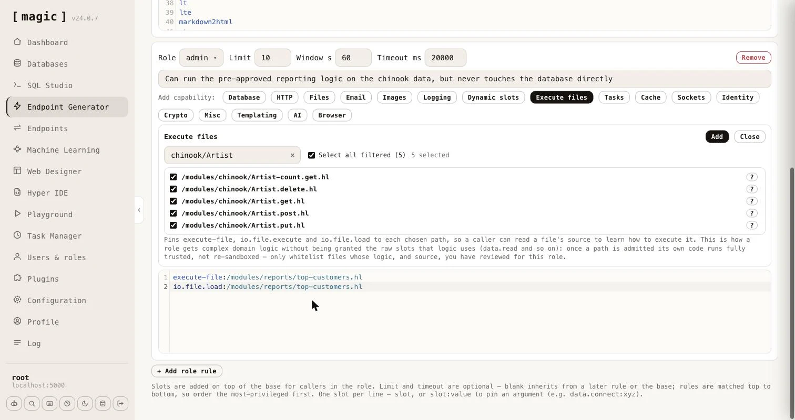

### Business logic without raw access

A whitelist answers _"which functions may this role call?"_ Often the better question is _"which results may this role get?"_ A role that should be able to see your top customers does not need **[data.connect]**, **[data.read]**, and the freedom to write SQL. It needs one piece of code that you wrote and reviewed, which returns exactly what it should and nothing else.

That piece of code is an ordinary Hyperlambda file. You write it the way you would write any other Hyperlambda - in [Hyper IDE](/dashboard/hyper-ide/), or by letting an AI agent create it over [MCP](/tutorials/how-to-connect-the-mcp-server/) - and it can be as complex as the job requires. A file in a module, such as the following, validates its own arguments and then talks to the database.

```
/*
 * Returns the customers who have spent the most.
 */
.arguments

   // Optional number of customers to return, between 1 and 100. Defaults to 10.
   limit:int

validators.default:x:@.arguments
   limit:int:10
validators.integer:x:@.arguments/*/limit
   min:int:1
   max:int:100

data.connect:chinook
   data.select:@"
select c.FirstName || ' ' || c.LastName as name, sum(i.Total) as total
   from Customer c
   inner join Invoice i on i.CustomerId = c.CustomerId
   group by c.CustomerId
   order by total desc
   limit @max_rows"
      max_rows:x:@.arguments/*/limit
   return-nodes:x:@data.select/*
```

Save it as `/modules/reports/top-customers.hl`. A file name without an HTTP verb in it, such as this one, is not an endpoint, so nobody can invoke it over HTTP - it can only be reached by code that executes it.

#### Granting the file instead of its functions

Open a role rule and click _"Execute files"_. The wizard lists every Hyperlambda file under `/modules/`, filterable, with a _"?"_ button next to each showing the file's description and its arguments. Tick the files this role may run - the _"Select all filtered"_ checkbox ticks everything the filter currently shows - and click _"Add"_.



For every file you tick, the wizard writes three lines, each pinned to exactly that path.

```
execute-file:/modules/reports/top-customers.hl
io.file.execute:/modules/reports/top-customers.hl
io.file.load:/modules/reports/top-customers.hl
```

The first two let the role run the file, and **[execute-file]** and **[io.file.execute]** are the same operation under two names, so both are granted. The third lets the role read the file's source, so a caller - typically an AI agent - can learn what arguments it takes and how it behaves before running it. The role is granted _nothing else_. It has no **[data.connect]**, no **[data.read]**, and cannot run SQL of its own.

A caller in that role can now do this.

```
execute-file:/modules/reports/top-customers.hl
   limit:int:5
return-nodes:x:@execute-file/*
```

The file runs, queries the database, and returns the five biggest spenders. If the same caller tries to reach the database directly - `data.connect:chinook` - the sandbox answers with the state `rejected`.

#### What makes this safe, and what you must still do

The whitelist stops applying to the code _inside_ a file it admitted, exactly as it already does inside a dynamic slot. Without that, the file's own **[data.connect]** would be refused, and the whole idea would be pointless. This is deliberate, and it moves the responsibility into the file, so a few rules matter.

* **Review the file, and its source.** Whatever you grant runs with the server's full vocabulary, and the role can read the source through **[io.file.load]**, so keep credentials and anything secret out of it. The wizard says so, too.
* **Validate arguments inside the file.** The caller chooses the arguments. Use validators as the example does, pass values to SQL as parameters, and never build SQL, file paths or URLs by concatenating what the caller sent.
* **Never run caller supplied code inside the file.** A file that evaluates a lambda it was given would hand the caller the full vocabulary again.
* **Pin the path.** Prefer an exact path to a wildcard, so that a new file dropped in the folder later does not silently become part of the role.

The _"Dynamic slots"_ wizard is the same idea for logic held in a dynamic slot, created at runtime with **[slots.create]**, which is kept in memory only. It grants **[execute]**, **[signal]** and **[try-signal]**, each pinned to the slot name. Files are the better choice for anything that has to survive a restart.
