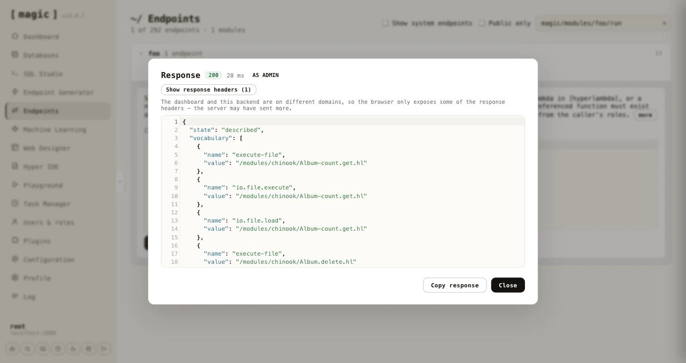

### Root, throttling and the timeout

Two settings sit above the policy.

* **Root bypasses the sandbox** - when on, a caller in the `root` role runs with the server's _full_ vocabulary and no whitelist at all. Root is trusted completely, so it is also never rate limited and never timed out, whether or not this is on - the setting only controls whether root additionally escapes the vocabulary restriction.
* **Return code** - when on, the response includes the generated or supplied code; when off, only the state, result and any reason come back, which is usually what an application calling the endpoint wants.

Rate limiting is per role, keyed by the caller's IP address, and the timeout cancels execution after the configured number of milliseconds - a caller's own code can shorten it, but never extend it.

### Who may call

The _"Who may call"_ row gates the endpoint itself, exactly as for the other generators - leave it empty for a public endpoint, or name the roles allowed to invoke it. A caller who gets past that gate is then further constrained by the policy.

When the endpoint is saved, the generator offers _"Open in Endpoints"_ and _"Open in Hyper IDE"_ next to the preview of what it wrote.

### Asking what is permitted - describe

Every generated endpoint accepts a **[describe]** argument. Set it to true instead of sending code, and the endpoint tells the caller what it may do, without executing anything and without counting against its rate limit.

```
{
  "state": "described",
  "vocabulary": [
    { "name": "add", "value": null },
    { "name": "execute-file", "value": "/modules/reports/top-customers.hl" },
    { "name": "io.file.load", "value": "/modules/reports/top-customers.hl" }
  ],
  "limit": 10,
  "window": 60,
  "timeout": 20000
}
```

The **[vocabulary]** is a list with one entry per granted function, carrying its **[name]** and its pinned **[value]**, which is null when the function is not pinned. It is a list, and not an object keyed by name, because the same function can be granted several times with different pinned values. The **[limit]**, **[window]** and **[timeout]** tell the caller how many calls it may make per window of seconds, and how many milliseconds a call may run. They are left out for root, which has neither. When _"Root bypasses the sandbox"_ is on, root is told the server's full vocabulary, together with `root-bypass: true`.



### As an MCP tool, and discovery without MCP

Because the generated endpoint is an ordinary Hyperlambda endpoint, it is also an MCP tool. Its file level comment becomes the tool's description. The generator writes it to match the input mode, lists every role's description as a markdown list, and tells the calling model to call the tool with **[describe]** set to true to learn its capability surface.

```
 * Accepts caller-supplied Hyperlambda in [hyperlambda], or a natural-language
 * [instruction] the Hyperlambda Generator turns into code.
 *
 * Roles:
 *
 * - **admin**: Can run the pre-approved reporting logic on the chinook data
```

An agent that is not connected over MCP can still find these endpoints. The first time the generator saves a Sandbox API endpoint, it creates `/etc/www/.well-known/` if it is missing, together with a pair of files - `hyperlambda-agent.html` and its code-behind `hyperlambda-agent.hl`, created from templates and never overwritten afterwards. Every endpoint the generator saves is then added to the code-behind, replacing its earlier entry when you regenerate it. Fetching `/.well-known/hyperlambda-agent` on your cloudlet returns JSON an agent can read without any setup.

```
{
  "about": "Sandboxed Hyperlambda endpoints on this server. ...",
  "base": "https://your-cloudlet.example.com",
  "endpoints": [
    {
      "path": "magic/modules/foo/run",
      "verb": "post",
      "description": "Sandboxed Hyperlambda endpoint, generated by ...",
      "auth": "admin"
    }
  ]
}
```

Each entry has the endpoint's **[path]** relative to **[base]**, its **[verb]**, its **[description]**, and **[auth]** only when you restricted who may call it. The code-behind is a plain, readable file, so you can prune or edit the list by hand.

### Testing an endpoint as a role

The Endpoints component and Hyper IDE both have a _"Run as"_ dropdown next to _"Invoke"_ - see [Endpoints](/dashboard/endpoints/). Choose a role, invoke with **[describe]** set to true, and you see exactly what a caller in that role is permitted, without creating a user for it.
