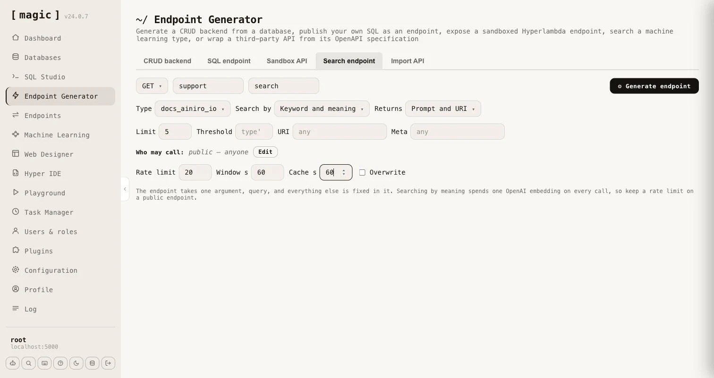

The _"Search endpoint"_ tab generates a single HTTP endpoint that searches the training snippets of one [machine learning](/dashboard/machine-learning/) type and returns the best matches. It is retrieval only - no AI model is invoked - which makes it a cheap and fast way to put your own knowledge behind an API, a website's search box, or an AI agent.

Everything except the query is fixed in the generated endpoint, so a caller cannot choose the type, the search mode or how much comes back. The endpoint takes one argument, **[query]**, and you choose the rest when you generate it.

* **Type** - the machine learning type whose training snippets are searched.
* **Search by** - the type's own setting, or _Keyword_ (BM25), _Keyword and meaning_, or _Meaning_. A search by meaning is always widened with keywords, unless the query has no words to match.
* **Returns** - _Prompt and URI_, or _Prompt, completion, URI and meta_. The snippet's internal id never leaves the endpoint.
* **Limit** and **Threshold** - how many matches come back, and how similar a match must be. Leave the threshold empty to use the type's own.
* **URI** and **Meta** - optionally restrict the endpoint to snippets belonging to one URL, or whose meta fits a pattern in which `%` matches any text, such as `FACT ==> %`. Snippets that declare functions and widgets are never returned.
* **Who may call** - exactly as for the other generators. Leave it empty for a public endpoint.
* **Rate limit** and **Window** - how many calls an IP may make per window of seconds. It defaults to 20 per 60 seconds, root is exempt, and 0 means no limit.
* **Cache** - a number of seconds the caller may cache an answer, sent as a **Cache-Control** header, and marked private when the endpoint is restricted to roles.

Searching by keyword needs no OpenAI key and costs nothing per call. Searching by meaning, or by both, spends one OpenAI embedding on every uncached call, so the tab reminds you to keep a rate limit on a public endpoint.

The generator writes a file level comment saying what the endpoint searches and returns, so it works as an [MCP](/tutorials/how-to-connect-the-mcp-server/) tool without any further work. Use _"GET"_ for an endpoint a website can call directly, and _"POST"_ if you prefer a body. Unlike the built-in public search endpoint, which takes the type as an argument, a generated endpoint has the type built in, its own URL, its own authorisation and its own response shape.
