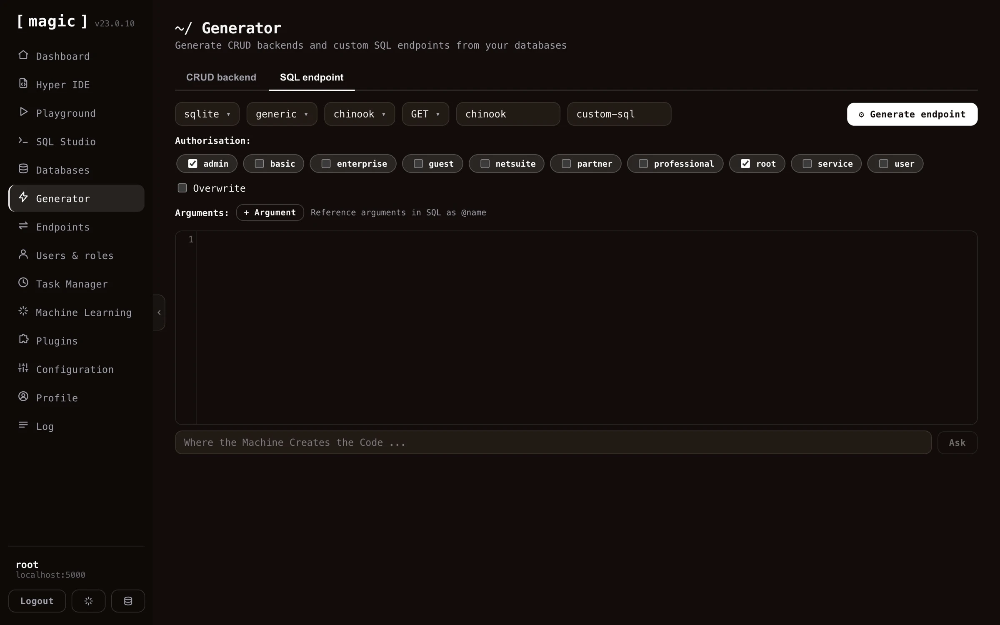
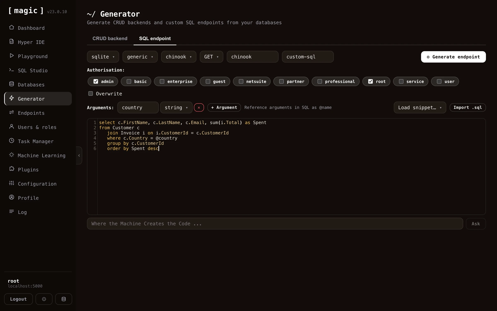

The SQL endpoint generator component allows you to generate an API endpoint wrapping an SQL statement. It is similar to the endpoint generator, but instead of automatically creating your SQL, it allows you to provide your own custom SQL, and then securely wrap your SQL into an HTTP endpoint. It allows you to create endpoints wrapping any of the 5 most popular HTTP verbs, takes care of authentication and authorisation, in addition to that it allows you to declare arguments to your endpoints.

Notice, you don't have to write the SQL yourself. Below the SQL editor you'll find an input textbox that says _"Where the Machine Creates the Code"_ - describe the query you want in plain English, click _"Ask"_, and the AI generates the SQL for you, aware of your selected database and its schema. If the editor already contains SQL, your prompt is treated as a change instruction, allowing you to iterate until the query does exactly what you want, before wrapping it into an HTTP endpoint.

## How to use the SQL endpoint generator

You can find the SQL endpoint generator as an additional tab inside your endpoint generator. The SQL generator is much simpler to understand than the endpoint generator, since it has much less settings you can apply. However, the SQL endpoint generator obviously requires that you've got a solid understanding of SQL. The process to use the SQL endpoint generator to create an endpoint is as follows.

1. Choose your database
2. Choose an HTTP verb
3. Choose URL(s) for your endpoint
4. Select which roles are authorised to invoke your endpoint (optional)
5. Provide arguments to your endpoint (optional)
6. Write your SQL referencing arguments if you provided arguments in the above step

When you're done with the above, simply click the _"Generate"_ button, and you've got an HTTP endpoint wrapping your SQL.

## Settings for the SQL generator

The SQL generator allows you to override authorisation requirements, the URL of your endpoint, and which arguments your endpoint requires. The last part is important since it allows you to add arguments to your endpoint that you can reference in your SQL somehow. To reference an argument in your SQL, prefix your argument's name with an at character (@), implying if your argument is named _"foo"_, you'll have to reference your argument in your SQL as _"@foo"_.

Notice, arguments supplied to your SQL endpoint are obviously mandatory, since once you've generated your endpoint, there are no known mechanisms for removing the argument from your SQL. However, your arguments could be supplied as null values, at which point the resulting SQL would use the value null as a substitute for your argument.

