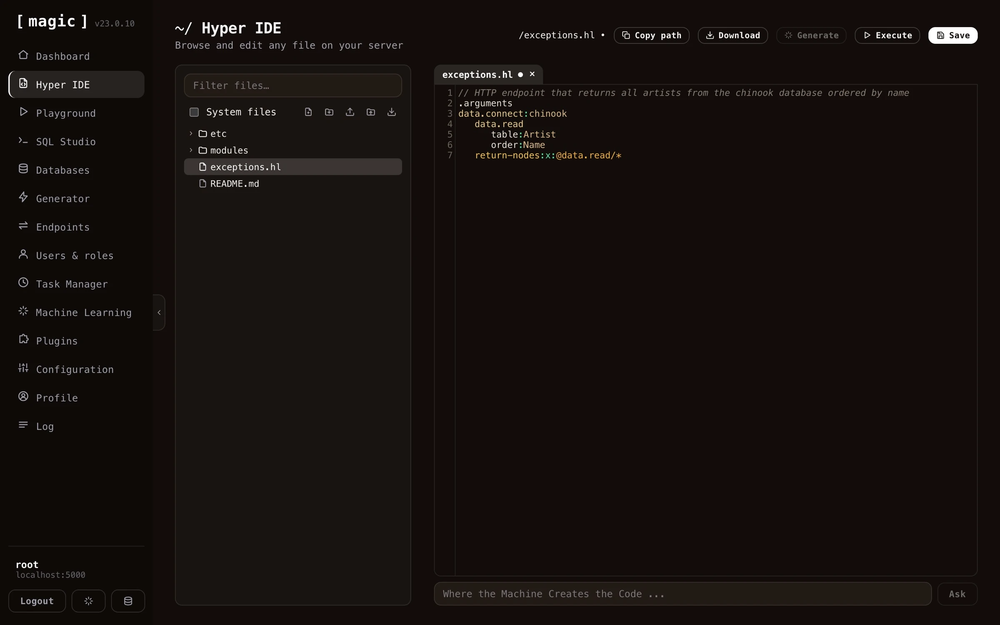
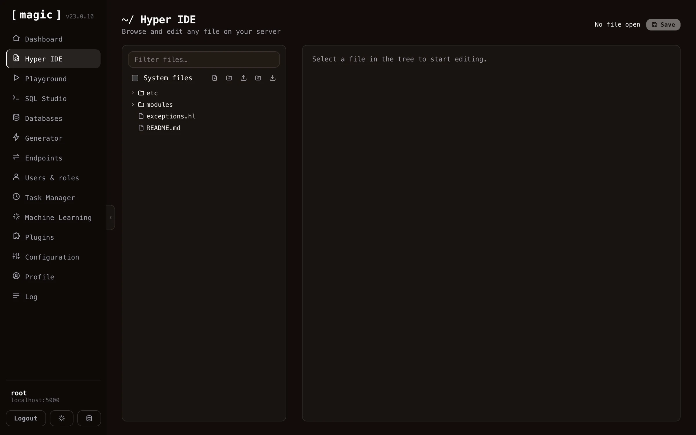
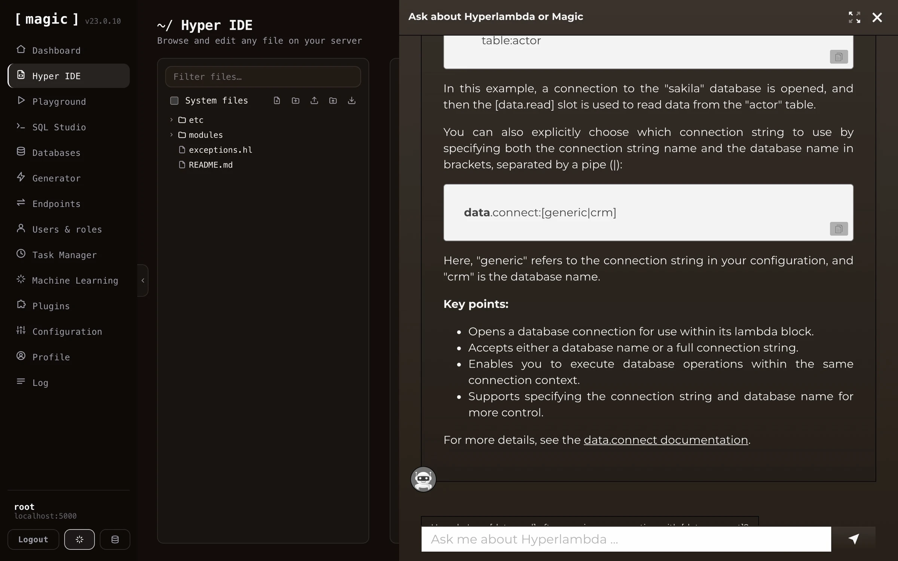
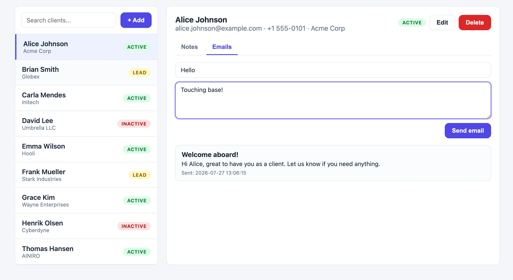
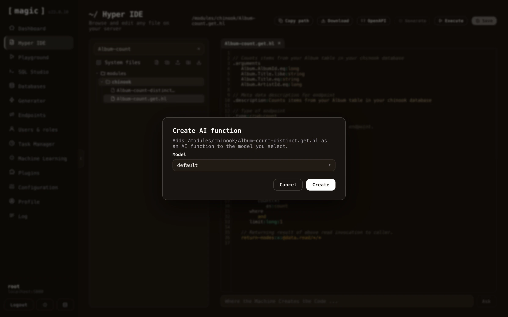

While Hyper IDE lets you write and generate code by hand, the _preferred_ way to build with Magic is to let an AI agent do the work for you. Magic exposes an [MCP server](/tutorials/how-to-connect-the-mcp-server/), and the recommended workflow is to connect an orchestrator AI - such as Claude, Cursor, Codex, Qoder, or any other MCP-capable harness - to your cloudlet, and use Magic as that agent's development _and_ deployment platform. Over the same MCP connector the agent can discover your endpoints, generate new Hyperlambda, create database schemas, wire up modules, and deploy them straight into production on your cloudlet. Hyper IDE then becomes the place where you inspect, tweak, and debug what the agent produced.

## Generating code with AI

At the bottom of Hyper IDE's editor you'll find a bar labelled _"Where the Machine Creates the Code"_. Type an instruction here in plain English, click _"Ask"_, and Magic generates or modifies your code according to your instructions - similar to how GitHub CoPilot works.

Which engine answers depends on the file you have open.

* **Hyperlambda files (`.hl`)** are generated by Magic's own [Hyperlambda Generator](/dashboard/hyperlambda-generator/). Currently this requires _no_ OpenAI API key and is _free of charge_ - the generator is our proprietary model, fine-tuned exclusively on Hyperlambda.
* **Other languages** - such as TypeScript, JavaScript, HTML, CSS, and SQL - are generated through OpenAI, and therefore require you to have an OpenAI API key installed in your cloudlet's configuration.

You can also select some text in the editor and click the _"Generate"_ button to run your selection through the generator, or write a file-level comment describing what you want and generate your code from that.

The bar works like a conversation, so you can keep refining and modifying your code, using it as an _"AI-based pair programming buddy"_. Requests are paired to a local machine learning model with the same name as your file's extension - so with an HTML file open the AI searches for a model named _"html"_, falling back to your _"default"_ model if none exists. This lets you create your own RAG models, matched to your file extensions, to teach the AI about your own code.

Hyper IDE also provides integrated autocomplete if your editor has focus and you click CTRL+SPACE in Windows or FN+CONTROL+SPACE on your Mac. This allows you to very rapidly create Hyperlambda code, while having Hyper IDE ensure your code is using existing slots. Notice, these keyboard shortcuts are only available when your code editor has focus.

In addition to autocomplete, the editor documents your code as you read it - rest your mouse pointer on any slot invocation in a Hyperlambda file, and a tooltip appears explaining what the slot does, using the descriptions your cloudlet's slots declare about themselves. And CTRL+F on Windows or COMMAND+F on your Mac opens search inside the editor, highlighting every match as you type, with ENTER cycling through them - which matters once your Hyperlambda files grow to hundreds of lines.

## Integrated Hyperlambda AI help

If you mark some Hyperlambda code in Hyper IDE and click F1, it will invoke AINIRO's machine learning model for Hyperlambda, and actually explain your code using natural language.

## Creating full stack apps

Hyper IDE isn't limited to backend code - you can create complete full stack applications from it. Since your cloudlet serves static files from `/etc/www/`, and the _"Where the Machine Creates the Code"_ bar generates HTML, CSS and JavaScript too, you can describe the frontend you want in plain English and have the AI build it - wired straight to the CRUD API the [Endpoint Generator](/dashboard/endpoint-generator/) created for your database. The CRM app below was built exactly this way; a SQLite database with 3 tables, a secure API wrapping it, and a working frontend - all generated from natural language.

## Turning your endpoints into AI functions

Hyper IDE also bridges your code and your [Machine Learning models](/dashboard/machine-learning/). Every Hyperlambda endpoint file has a _"Create AI function"_ action, adding that endpoint as an AI function to a model you select - allowing your chatbot or AI agent to invoke it. Folders have the same action, converting _all_ Hyperlambda endpoint files inside the folder into AI functions in one go. Endpoint files also have an _"OpenAPI"_ action, showing you the endpoint's OpenAPI specification.

