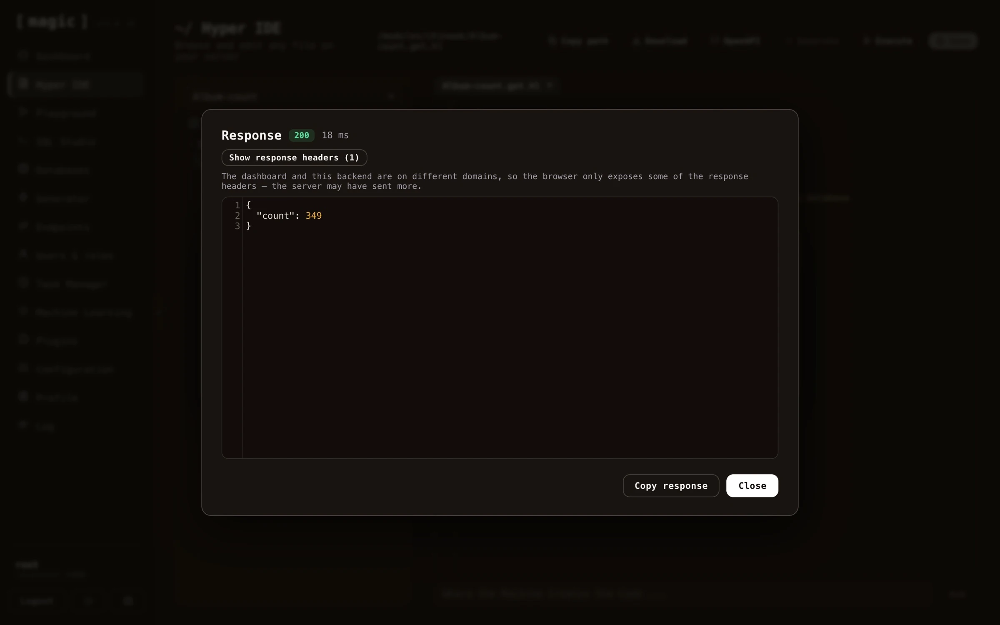
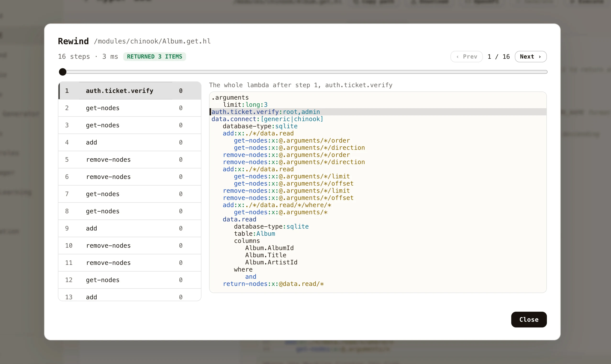

The dashboard documents its own shortcuts - click CTRL+/ (COMMAND+/ on a Mac) anywhere, and an overview opens listing every shortcut, or find it by opening the command palette with CTRL+K and typing _"keyboard"_. The complete list is as follows.

| Shortcut | Where | What it does |
| --- | --- | --- |
| CTRL/CMD + K | Everywhere | Opens the command palette - jump to any page, file, endpoint, task or model |
| CTRL/CMD + / | Everywhere | Shows the keyboard shortcut overview |
| CTRL/CMD + . | Everywhere | Opens [Chat Ops](/dashboard/chat-ops/) - the dashboard's own AI agent |
| ESC | Everywhere | Closes the open dialog |
| CTRL + SPACE | Code editors | Autocomplete - Hyperlambda slots, SQL tables and columns |
| CTRL/CMD + F | Code editors | Search inside the editor - ENTER cycles matches, ESC closes |
| ALT + M | Code editors | Toggles fullscreen editing - ESC leaves fullscreen |
| TAB / SHIFT + TAB | Code editors | Indents or outdents the selection one level |
| CTRL/CMD + S | Code editors | Saves the open file |
| F5 | Code editors | Executes - runs the open file, snippet or SQL |
| F1 | Code editors | Asks the AI to explain the selected Hyperlambda |
| ALT + A | Hyper IDE | New file |
| ALT + B | Hyper IDE | New folder |
| ALT + R | Hyper IDE | Renames the open file |
| ALT + D | Hyper IDE | Deletes the open file |
| ALT + X | Hyper IDE | Deletes the active folder |
| ALT + C | Hyper IDE | Closes the open file |
| ALT + F | Hyper IDE | Switches to the next open file |
| ALT + P | Hyper IDE | Switches to the previous open file |

Editor shortcuts require the code editor to have focus, and apply in every editor throughout the dashboard - Hyper IDE, the Hyperlambda Playground, and SQL Studio alike.

On macOS the combos follow the platform's conventions, and the in-dashboard overview shows the macOS variants automatically: COMMAND substitutes for CTRL, OPTION for ALT, autocomplete is FN+CONTROL+SPACE, and the function keys need FN unless you have configured them as standard function keys.

## Hyper IDE features

Hyper IDE is not a fully fledged IDE, and cannot compare to something like VS Code or Visual Studio. However, its purpose is to function as an extension on top of the endpoint generator, giving you code editing capabilities of your generated Hyperlambda files - In addition to rapidly allowing you to edit Hyperlambda files and use AI to generate or modify existing code.

You _can_ use Hyper IDE to edit TypeScript, Ruby, HTML, and C# code, but we don't recommend replacing it with your existing code editor, since other IDEs have much more features here than Hyper IDE. However, the opposite is also true, implying Hyper IDE has features your existing IDE does not have - Especially in regards to [Hyperlambda](/hyperlambda/).

Another benefit is that Hyperlambda is a dynamic programming language, implying once you've saved your Hyperlambda files, you can immediately test your code by executing it from within Hyper IDE by clicking F5. This results in a much tighter development model than a traditional compiled programming language gives you, making it much faster to find bugs and create working code.

If you execute code in immediate mode using F5, and your code requires arguments, Hyper IDE will ask you for what to pass in as arguments. This isn't perfect, and only works for first level arguments - But if you need more complexity, you can always use the [Hyperlambda Playground](/dashboard/hyperlambda-playground/), and/or the [Endpoints Component](/dashboard/endpoints/).

Magic does not separate between code creation and your code's production environment, providing you with instant feedback as you create your code.

Hyper IDE also remembers which files you had open, per cloudlet - sign out, come back tomorrow, and your workspace opens the way you left it, with the same files in the same tabs.

## Executing Hyperlambda from Hyper IDE

Hyper IDE allows you to execute Hyperlambda without ever leaving your IDE by clicking the _"Execute"_ button. This makes it easy for you to test your code as you are creating it. When executing an API endpoint file, you can parametrise the invocation, and the result is shown with its HTTP status code, execution time, and response body. The same dialog also lets you _debug_ the file instead of simply invoking it, which is described below.

The dialog also has a _"Run as"_ dropdown, listing every role on your cloudlet. Choose a role and _"Invoke"_ calls the endpoint with a short lived token minted for that role, so you can see what a caller holding only that role would be allowed to do, and what they would get back - without creating a user for it. Its [description in the Endpoints component](/dashboard/endpoints/) applies here too, since both use the same panel. Notice that _"Debug"_ always runs as you, because debugging goes through the evaluator, which only root may use.

## Rewind - stepping through an execution

Executing a file tells you what it returned. **Rewind** tells you how it got there.

Fill in your arguments as you normally would, then click _"Debug"_ instead of _"Invoke"_. Magic runs the file while recording **every single slot it invokes**, and hands you the recording. Each entry carries the whole lambda object as it looked immediately after that slot ran - so moving through the list is watching your program's own state evolve, rather than reading a stack trace and guessing what the values were.

The screenshot above is a generated CRUD endpoint at its first step. On the left is every slot that executed, in order, with how many milliseconds each took. On the right is the entire lambda at that moment, with the statement that just ran highlighted - and `limit:long:3`, the argument that was supplied, sitting in `[.arguments]` where the code will read it.

### Moving around

* **Click any step** in the list to jump to it, and the code highlights the statement it was executing.
* **Arrow keys** step back and forward - left and up go back, right and down go forward.
* **Drag the scrubber** to move through a long recording quickly.
* The header shows how many steps were recorded, how long the whole execution took, and what the code returned.

### When something throws

An execution that fails is the one most worth recording, so the failure is captured rather than discarded. The statement that threw is marked in red in both the step list and the code, and the exception message appears in the header - click it to jump straight to the statement that caused it.

Crucially, you keep everything that happened *before* the failure. If a loop ran correctly forty times and the forty-first statement threw, you can see the state the loop had built up at the moment it broke, which is precisely what a stack trace never tells you.

### Notes

Recording is opt-in, per execution, and lives only in memory - nothing is written anywhere, and there is no cost at all to the code you run normally. Lambdas evaluated on background threads through [fork] are not recorded, since they are not part of the execution you asked about. Very long recordings are capped, and say so when they have been truncated.
