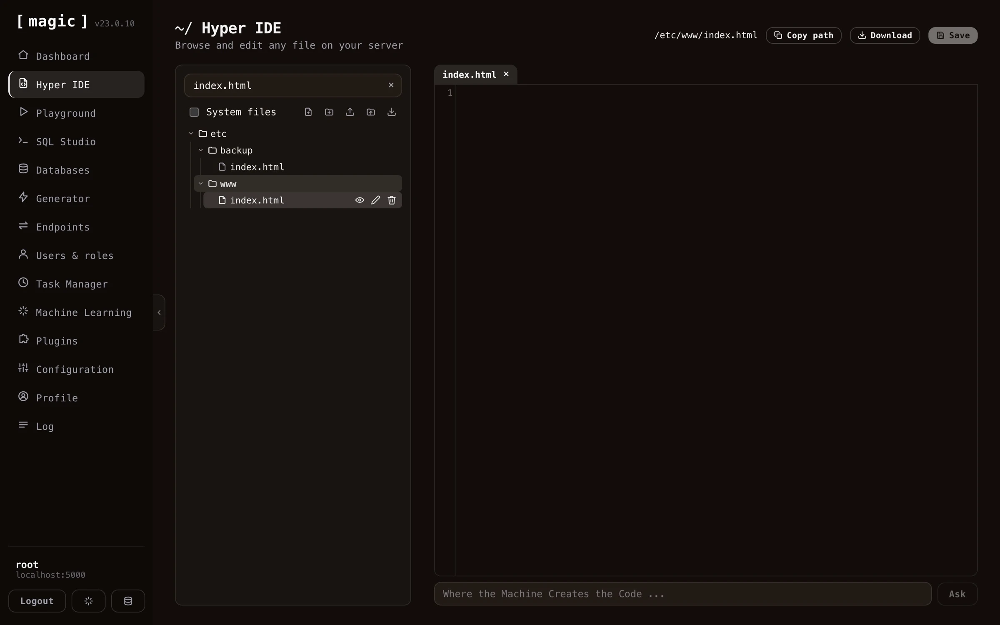

Hyper IDE isn't only for Hyperlambda. Anything you place under the `/etc/www/` folder is served directly from the root of your cloudlet's domain by the backend, which turns Magic into a web server too. A file saved as `/etc/www/index.html` is served from your site's root, `/etc/www/css/main.css` from `/css/main.css`, and so on. This means you can host a landing page, a complete static website, or the HTML, CSS and JavaScript assets for a single-page application straight from your cloudlet, right next to the APIs that power it. Notice, hidden files and folders - those starting with a dot - are _not_ served, with the exception of `.well-known`, which the backend deliberately exposes so discovery documents remain publicly reachable.

You edit these files the same way you edit any other file in Hyper IDE. Create or open an HTML, CSS, JavaScript, Markdown, or image file underneath `/etc/www/`, and edit it either the good old fashioned way by typing, or with the AI constructs described above - the _"Where the Machine Creates the Code"_ bar and the _"Generate"_ button work for HTML, CSS and JavaScript too. Since these are not Hyperlambda, they're generated through OpenAI, so they require an OpenAI API key in your configuration.

When you're editing a file that lives under `/etc/www/`, Hyper IDE gives you a _"Preview"_ action on the file, that opens the served page in a new browser tab, allowing you to see your changes exactly as a visitor to your site would.

## Modules

Magic is modularized, allowing you to easily move modules from one machine to another. This is the purpose of your _"/modules/"_ folder, as in each folder inside this folder is considered a module in Magic.

If you're developing a module in your own local installation of Magic, you can mark the folder in the tree control, and click the action button for downloading the folder. This will give you a zip file you can easily upload to another server using the install module action button.
