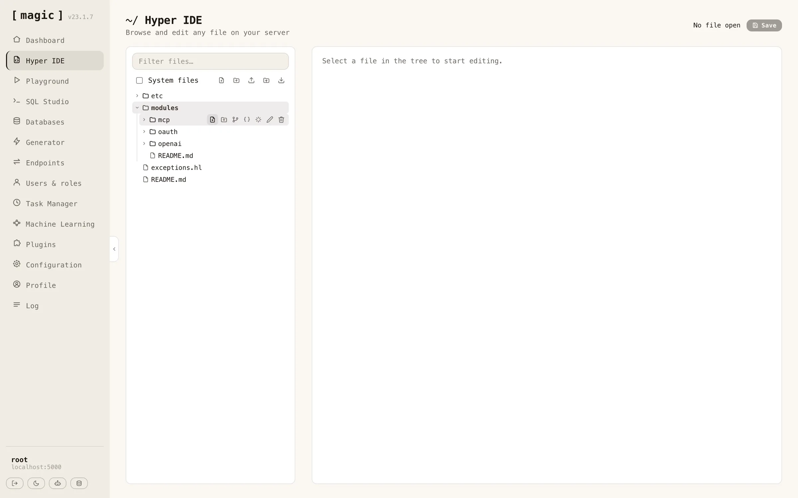
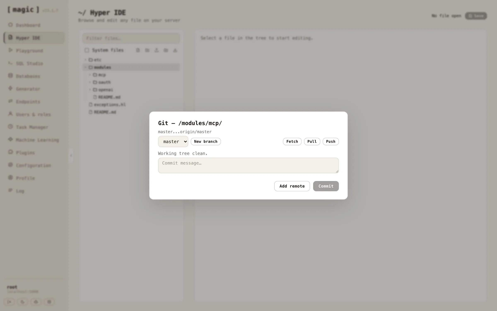
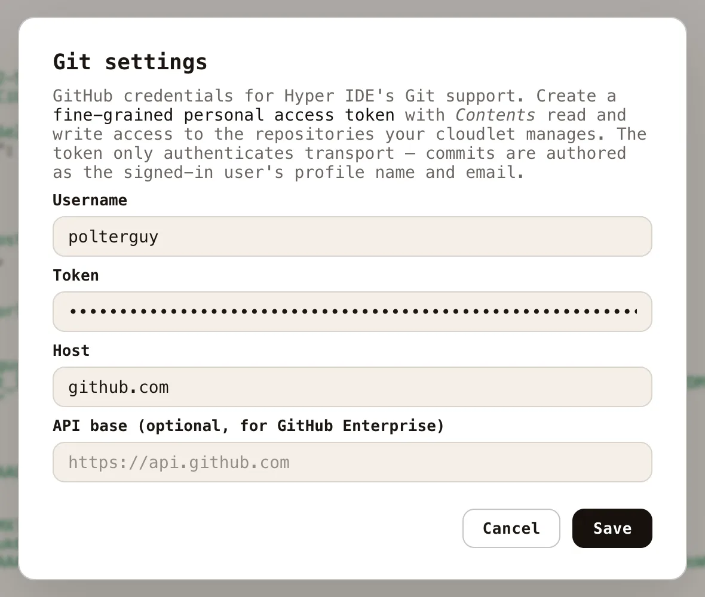
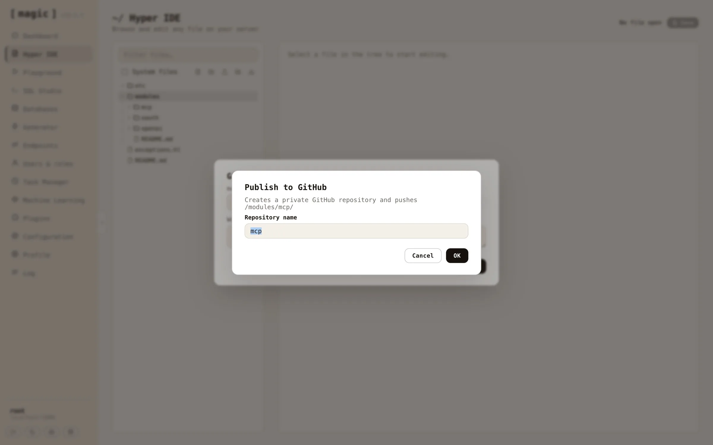
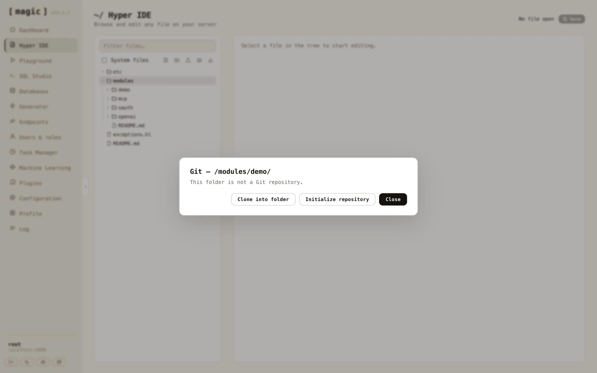
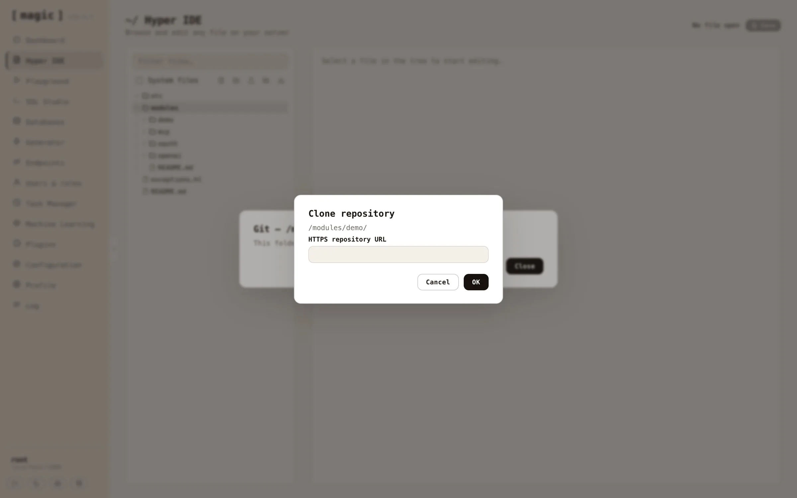

Every module can be its own Git repository, and Hyper IDE has Git built in. Top level folders inside your _"/modules/"_ and _"/etc/"_ folders are treated as repository roots, and hovering such a folder in the tree reveals its action buttons - the branch icon opens the Git panel for that module.

For a folder that already is a repository, the panel shows which branch you're on, whether you're ahead of or behind your remote, and every modified and untracked file. From here you can commit all changes with a message, push and pull, fetch from your remote, switch branches, and create new branches. Buttons that cannot possibly work in the repository's current state are disabled - push for instance is only enabled when you actually have commits your remote doesn't.

Each changed file is a row you can expand. Expanding it shows the file's diff against HEAD, with additions and removals coloured, so you can read exactly what a commit will contain before writing its message. Untracked files show their whole content as additions, since there is no earlier version to compare with. Hovering a tracked file's row reveals a reset button that throws away that file's uncommitted changes and restores what HEAD has - both in the working tree and in any tab you have the file open in, so a later save cannot bring the discarded content back. The _"Reset to HEAD…"_ button does the same for the entire repository, and in addition deletes every untracked file and folder, leaving the module identical to its last commit. Both ask for confirmation first, and neither can be undone.

Before your first commit, add your GitHub username and a fine-grained personal access token with _"Contents"_ read and write access to your configuration. Open the _"Configuration"_ screen, click the hamburger menu at the top, and choose _"Git…"_ to get a dialog doing this for you.

Authentication is injected per invocation over HTTPS; nothing is ever written to the server's global Git configuration, and no SSH keys are involved. Commits are attributed to _you_ - the author name and email are resolved from the authenticated user's profile, so commits made from Hyper IDE show up on GitHub with your name on them, not some shared server identity.

### Publishing a module as a new GitHub repository

To turn an existing module into a brand new GitHub repository, hover the module's folder and click the Git action. If the folder isn't a repository yet, click _"Initialize repository"_ first, then write a commit message and click _"Commit"_. With your first commit in place, click _"Publish to GitHub…"_, and give your new repository a name - it defaults to the module's folder name.

One click later your module exists as a _private_ repository on GitHub, wired up as the module's _"origin"_ remote, with your commit pushed and upstream tracking configured - the panel creates the repository, adds the remote, and pushes in one go. Flip the repository to public on GitHub if that's what you want. Notice, _creating_ repositories requires the account level repository creation permission on your access token, in addition to the _"Contents"_ permission that reading and writing them needs.

### Cloning an existing GitHub repository

To deploy a module you already version control on GitHub, create a new _empty_ folder inside _"/modules/"_ using the new folder action, then open the Git panel on it. A folder that isn't a repository offers you two paths - cloning into it, or initializing it as a new repository. _"Clone into folder"_ is only enabled while the folder is empty, since Git refuses to clone into a folder with existing contents.

Click _"Clone into folder"_ and paste the repository's HTTPS URL - cloning checks out whatever the remote's default branch is, and your module is running on the cloudlet with its full history attached.

Since modules are self-contained folders, this gives you version control per module; develop a module on one cloudlet, publish it to GitHub, and clone it into another cloudlet - a natural companion to the zip-based module install described above, with history, branches and rollback included.

## Continuous Integration and Deployment

You can even connect creation of such modules, and automatically deploying them to production through for instance a GitHub action using CI/CD, by creating a token using the _"Generate token"_ feature on your Profile screen. This gives you a JWT token you can use to authenticate a process, such that it's allowed to invoke your `/magic/system/file-system/install-module` endpoint. This will allow you to automatically upload a zip file, and re-install it after uploading it.
