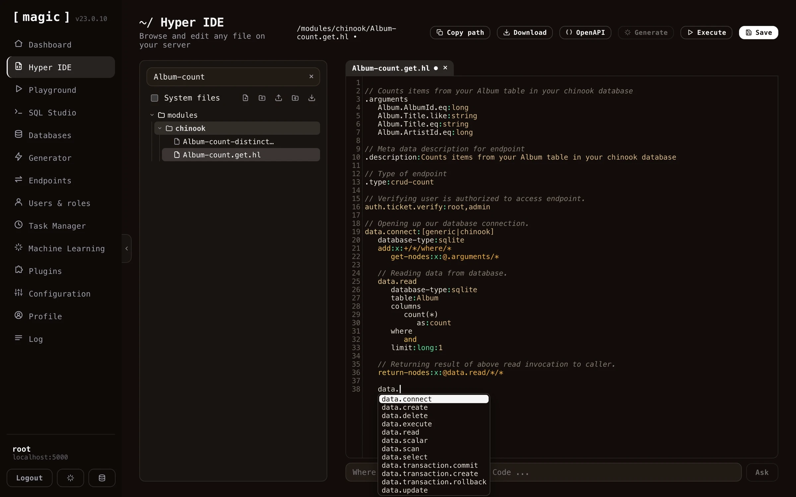

Hyper IDE is your _"goto component"_ when you want to create your own modules using Magic and Hyperlambda. It's a web based IDE, allowing you to edit your code, create new modules, and contains a lot of things you're used to from a traditional IDE. It is also the natural extension of Magic's [endpoint generator](/dashboard/endpoint-generator/), since it allows you to edit the Hyperlambda endpoint files after Magic has generated your CRUD backend. In addition, Hyper IDE allows you to use AI to generate code using _"vibe coding"_ constructs.

## In this section

* [Hyper IDE - AI Code Generation](/dashboard/hyper-ide/ai-generation/): While Hyper IDE lets you write and generate code by hand, the preferred way to build with Magic is to let an AI agent do the work for you.
* [Hyper IDE - Editor, Shortcuts and Rewind](/dashboard/hyper-ide/editor/): The dashboard documents its own shortcuts - click CTRL+/ (COMMAND+/ on a Mac) anywhere, and an overview opens listing every shortcut, or find it by opening the command palette with CTRL+K and typing "
* [Hyper IDE - Files and Modules](/dashboard/hyper-ide/files-and-modules/): Hyper IDE isn't only for Hyperlambda.
* [Hyper IDE - Git and CI/CD](/dashboard/hyper-ide/git-and-deployment/): Every module can be its own Git repository, and Hyper IDE has Git built in.


