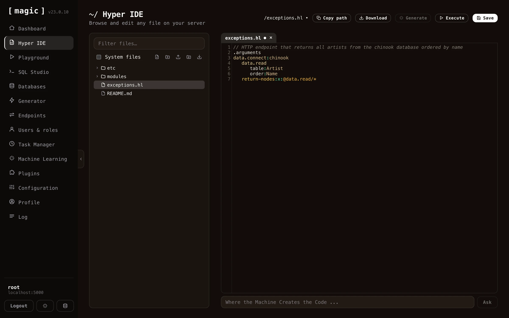
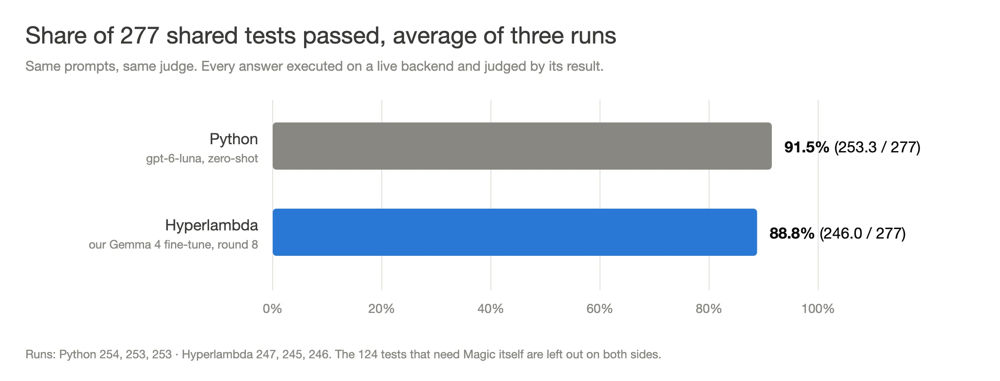
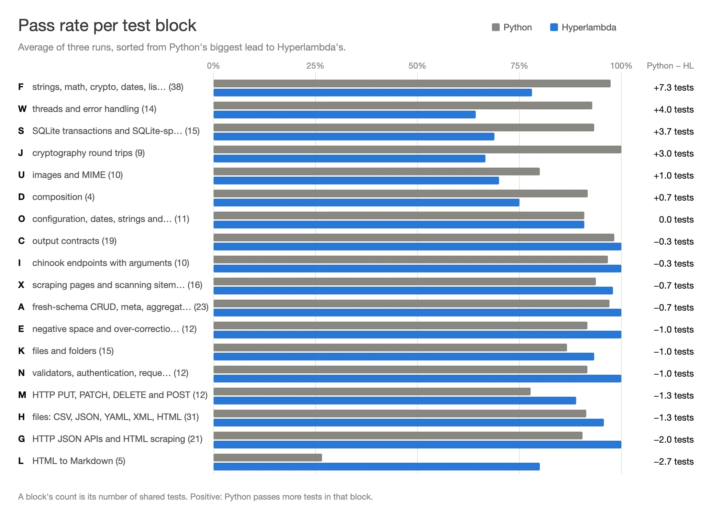
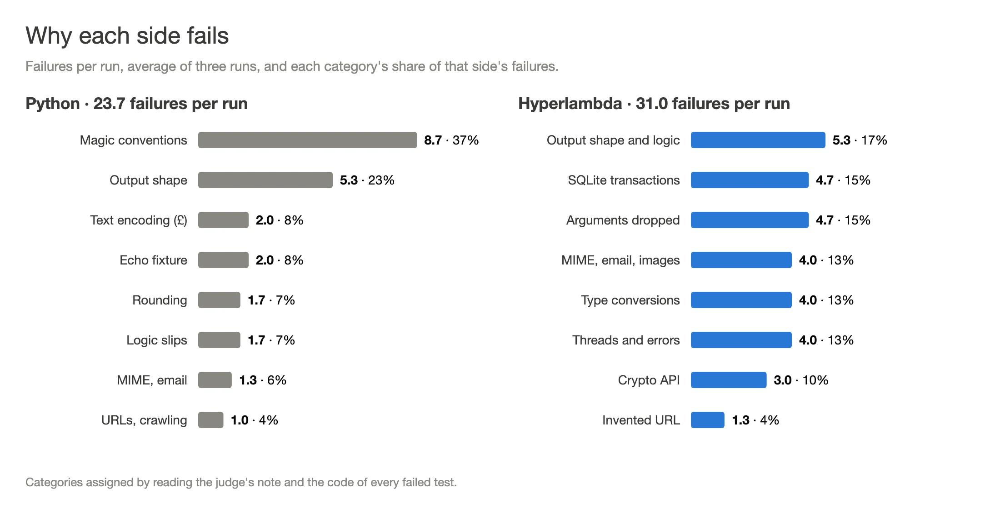

Magic contains its own Hyperlambda Generator. This isn't a single component, but goes through most parts of the platform that somehow allow you to create Hyperlambda code. It's built as our own proprietary SLM (Small Language Model), fine-tuned with more than 600,000 training snippets, so it's actually very strong on creating backend code, even though it's using a _"small base model"_.



## What makes it different

* **It's fast** - Since it's a small model, it typically generates your code in 1.5 to 5 seconds, allowing you to iterate rapidly, and allowing AI agents to create tools without noticeable delay.
* **It cannot hallucinate function invocations** - Every slot the generated code invokes is verified against the slots that actually exist in your cloudlet before the code is returned. If the model invokes something that doesn't exist, the code is rejected and regenerated - You will never be handed code invoking made-up functions.
* **It's trained exclusively on Hyperlambda** - More than 600,000 training snippets covering the entire platform; database access, HTTP endpoints, authentication, validation, email, file handling, scheduling, etc.
* **It's built for AI agents** - The generator is available over the [MCP server](/tutorials/how-to-connect-the-mcp-server/), allowing a connected AI agent such as Claude to create new endpoints - and hence new tools for itself - on demand.

You have to write _"formal specifications using technical language"_, in order for it to understand what to do. But if you've got some basic knowledge about software development, you should be able to rapidly understand how to use it. Below are some examples of prompts to give you an idea.

* _"HTTP endpoint that selects rows from Artist table in chinook database, including Album rows for each individual artist. Use ArtistId as foreign key"_
* _"Executable Hyperlambda file that sends an email using [name], [email], [subject], and [body] arguments. Endpoint can only be executed by root and admin accounts"_

## How accurate is it?

We measure the model behind the generator on 401 plain-English tasks, covering database CRUD, endpoint generators, files, HTTP, cryptography, sandboxes, background tasks, MIME, threads and scraping. Every answer is executed against real databases, files and HTTP endpoints, and it only passes when it does the job. The current model, round 8 of our fine-tune of Google's open Gemma 4 26B-A4B, with about 4 billion parameters active per token, passes **79.2% of all 401 tests** (317.7 on average over three runs). Our previous model, a GPT-4.1-mini fine-tune, passed 60.8%.

To see how that compares with a frontier model in the language it knows best, we gave gpt-6-luna the 277 tasks plain Python can also do, with the same prompts and the same judge, and asked it for Python. Python passed **91.5%** (253.3 of 277) and the generator, writing Hyperlambda, passed **88.8%** (246.0 of 277).



| | Run 1 | Run 2 | Run 3 | Average | Pass rate |
|---|---:|---:|---:|---:|---:|
| Python, gpt-6-luna | 254 | 253 | 253 | 253.3 | 91.5% |
| Hyperlambda, the generator | 247 | 245 | 246 | 246.0 | 88.8% |

The gap is 2.7 points, and it is not statistically significant on these tests: only 50 tests split the two sides, 29 that only Python passes against 21 that only Hyperlambda passes. Python is ahead on strings and maths, threads, SQLite transactions and cryptography. The generator is ahead on HTML to Markdown, HTTP APIs and scraping, HTTP verbs and files, the jobs where Hyperlambda has one command for what takes a library and a dozen lines in Python.



The two sides fail differently. More than a third of Python's failures are Magic conventions the prompts take for granted, such as Magic's Markdown style, rather than wrong code. The generator's failures are real mistakes, spread over transactions, dropped argument declarations, MIME, type conversions, threads and cryptography, and they are what the next training round is aimed at.



To read these numbers fairly: we wrote the tests ourselves, the generator gets up to three attempts when its answer does not parse, and the 124 tests left out of the Python comparison, which need Magic itself, are where the model is weakest, at 58%. The full method, the failure analysis and every prompt both models got are in [Python 91.5%, Hyperlambda 88.8%: Frontier Results From a Small Lab](https://hyperlambda.dev/blog/python-91-5-percent-hyperlambda-88-8-percent-frontier-results-from-a-small-lab), and you can try the model yourself on the [Natural Language API page](https://hyperlambda.dev/natural-language-api).

## How to use it

If you go to Hyper IDE for example, and you create a new Hyperlambda file (extension ".hl"), you can simply write normal text into the file, describing what you want the code to do. Then select your text and click the _"Generate"_ button, and your description is sent through our LLM, transforming your English into working Hyperlambda that replaces your selection. This makes the workflow as natural as writing a comment; describe the intent, select it, generate - and the comment becomes code.

**DISCLAIMER** - Magic and Hyperlambda isn't really an _"all purpose language"_, it's an orchestration language. If you're using it for complex algorithms, you're doing something wrong. So whatever description you supply, must be something that is a good fit for Hyperlambda. Below is an example of the type of code the generator produces from a similar prompt.

```text
/*
 * Endpoint: chinook.artist.read
 * Purpose: Reads artists from chinook database, including albums for each artist.
 * Access: Root users only.
 */
.arguments
auth.ticket.verify:root
data.connect:chinook
   data.read
      table:Artist
   include:x:@data.read/*
      data.read
         table:Album
         where
            and
               ArtistId.eq:x:@.dp/#/*/ArtistId
      yield
         albums:x:@data.read/*
   yield
      artists:x:@data.read/*
```

Notice, if the AI creates wrong code, you can press `CTRL+Z` (or `CMD+Z` on a Mac) to undo the generator's changes, then edit your description to be more specific and generate again.

## Modifying your code with AI

Below your main code view in Hyper IDE and the Hyperlambda Playground, you can see an input textbox that says _"Where the Machine Creates the Code"_. This bar allows you to provide change instructions to the LLM. Examples of prompts you might want to test can be found below.


* Add a name argument and use this when sending the email
* Make the title argument mandatory
* Log all incoming arguments
* Etc ...

## Security

The generator is built to be safe to hand to an AI - or to your users - without supervision.

* **It cannot hallucinate function invocations** - The generator's vocabulary is closed; every slot the generated code invokes is verified against the slots that actually exist in your cloudlet, and code invoking anything else is rejected and regenerated. Read the deep-dive at [hyperlambda.dev](https://hyperlambda.dev/blog/zero-hallucination-code-generation-a-vocabulary-your-ai-cannot-escape).
* **Generated endpoints are secured** - Endpoints created by the generator declare their own authorisation requirements through **[auth.ticket.verify]**, so RBAC applies to AI-generated code exactly as it applies to code you write yourself.
* **Untrusted code can be sandboxed** - Hyperlambda's **[whitelist]** slot lets you execute partially untrusted Hyperlambda with an explicitly declared vocabulary, so even dynamically generated code can be constrained to exactly the slots you allow. See [how whitelist executes partially untrusted Hyperlambda safely](https://hyperlambda.dev/blog/how-i-use-whitelist-to-execute-partially-untrusted-hyperlambda-safely).


