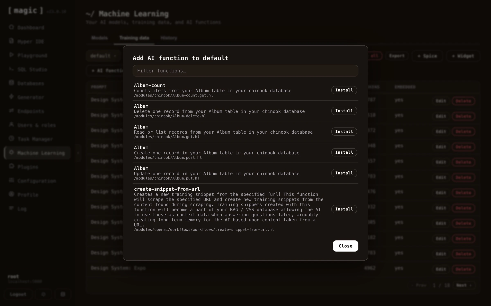

This is a subject on its own, but basically a machine learning model has the ability to execute AI functions. This works by instructing OpenAI to respond with the path to a Hyperlambda file and some JSON arguments given some specific condition(s). To understand AI functions, you can read the following tutorial.

* [Getting started with AI Functions](https://ainiro.io/blog/getting-started-with-ai-functions)

But basically an AI function training snippet resembles the following.

```text
This workflow will send an email,
with the specified [reply-to], [reply-to-email], [subject] and [body].
All arguments are mandatory, and [body] can be Markdown, at which point it
will be transformed into HTML before transmitted.

If the user asks you to perform an action associated with this function
invocation, then inform the user of what you are about to do, and do not
return follow up questions, but instead end your response with the
following:

___
FUNCTION_INVOCATION[/system/misc/workflows/send-email.hl]:
{
  "name": "[VALUE]",
  "email": "[VALUE]",
  "reply-to": "[VALUE]",
  "reply-to-email": "[VALUE]",
  "subject": "[VALUE]",
  "body": "[VALUE]"
}
___

Description of arguments:

* name Type of argument is string.
* email Type of argument is string.
* reply-to Type of argument is string.
* reply-to-email Type of argument is string.
* subject Type of argument is string.
* body Type of argument is string.
```

The above tells OpenAI to return JSON and `FUNCTION_INVOCATION` if the user asks it to send an email. This results in a _"function invocation"_ in the cloudlet, which is executed, for then to send the result of the invocation back to OpenAI again to answer the original question.

Magic Cloud contains dozens of pre-defined functions, and most of these are easily implemented using no-code constructs. To integrate one of the pre-defined AI functions into your model, you need to choose your model in the _"Training data"_ tab, click the _"Add function"_ button, at which point you'll see all the pre-defined no-code AI functions existing in the system.



## Count albums

Counts albums in the chinook database, optionally filtered by title.
Invoke this function when the user asks how many albums exist.

```plaintext
___
FUNCTION_INVOCATION[/modules/chinook/Album-count.get.hl]:
{
  "Album.Title.like": "[string]"
}
___
```
~~~

Notice, below is an example of the type of instruction the _"System message"_ setting expects.

```text
You are Frank, a sales executive for Acme, Inc. Follow these rules
when replying to my questions:

* You must answer all my questions exclusively based upon the
  information found in the context
* You may suggest relevant products and services you find in
  the context
* You should respond with short answers unless asked to elaborate
* You must respond with Markdown
* You should return relevant images and hyperlinks formatted
  as Markdown
* You may use emojis if it makes sense
* If you cannot find the answer to the question in the context,
  then inform the user that you are only configured to answer
  questions about Acme, Inc. and that the user should provide
  some keywords for you to find relevant information
```

Magic contains several pre-defined flavors, including dynamically created flavors that will scrape some page to create a highly personalised and custom system message that OpenAI will use as its instruction when it is asked questions. Dynamic flavors contain the text _"DYNAMIC"_ as a part of their name, and when selected, it will ask you for a website URL from where to extract information.

Notice, the system message can contain Hyperlambda mixin logic, similarly to how training snippets can. To understand how this works, read the section about adding Hyperlambda code to your training snippets. The system message can also contain AI function declarations, instructing OpenAI to return JSON for a function invocation given some specific instruction, such as for instance _"Search the web for Thomas Hansen Hyperlambda."_

#### Configuration settings

* Model name, being the name of your model. This cannot be changed once created.
* Website, which if supplied, will re-crawl the specified website once every 24 hours.
* Flavor, being a pre-defined list of templates for system messages. Once you select a flavor, your system message will update accordingly.
* System message, implying the _"instruction"_ to OpenAI. Allows you to change your chatbot's behaviour.
* Conversation starters, implying a pre-defined set of suggested questions to start a conversation with the chatbot.
* Greeting, being a static initial greeting, such as for instance _"Hello there, how can I help you?"_
* Authorisation, implying roles users must belong to in order to query model. Requires the user is authenticated through Magic with a valid JWT token if you turn this on.
* reCAPTCHA, being reCAPTCHA value for accepting queries. This is a legacy setting and you should set it to 0 since we've implemented our own PoW-based CAPTCHA library that's 0.1% of the size of reCAPTCHA.
* Supervised, which if turned on, will store all questions/answers allowing you to access these through the history tab.
* Vectors, implying the chatbot will use the vector database to find context. We do _not_ recommend turning this off.
* API key, being overridden OpenAI API key for a specific model. By default Magic will read API key from your configuration. You can override this on a per-model level.
* No requests, being total number of requests the chatbot has answered the current month.
* Max requests, implying maximum requests the chatbot will answer per month. Useful to cap your chatbot to avoid runaway costs. Logically it's using no requests to see if it can continue answering requests.
* Temperature, implying chances the OpenAI model is willing to take. Sometimes referred to as _"creativity"_.
* Threshold, implying threshold for training data to kick in. Similarity value allowing you to filter out any training data not matching. This value can be between 0 and 1, where 0 implies _"match anything"_ and 1 implies _"only match 100% equal snippets"_. A good value here is between 0.2 and 0.6, depending upon how strict you want the chatbot to match towards your training data.
* Completion/chat model, implying the OpenAI base model to use for queries.
* Vector model, implying vector model to create embeddings for your training data.
* Max Context tokens, implying how many tokens from your training data the model will maximumly use when sending your context to OpenAI to answer questions.
* Max Request tokens, implying the maximum number of tokens the model allows for the user's questions.
* Max Response tokens, implying maximum tokens to allow for OpenAI to return as answers to questions.
* Max Message tokens, which is calculated according to your completion model's token size, and your request, response and context tokens. If this goes to negative, your settings cannot be saved.
* Max Function Invocations, which is the maximum number of times the model will invoke OpenAI for a single prompt. To understand this number you'll have to read our tutorial about [how to create AI functions](https://ainiro.io/blog/getting-started-with-ai-functions).
* Max Session Items, which is the maximum number of historical requests and answers the model will keep in its session when invoking OpenAI before it starts pruning older messages.
