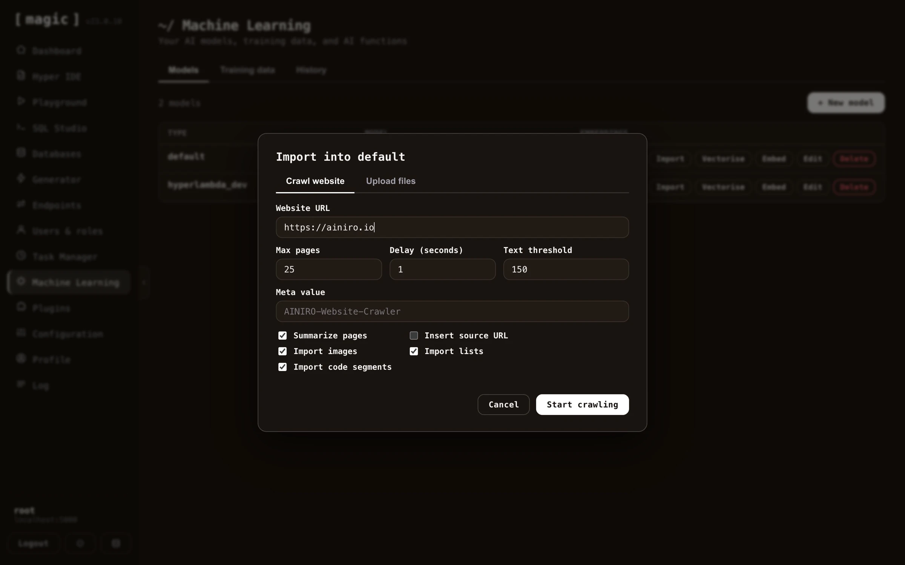
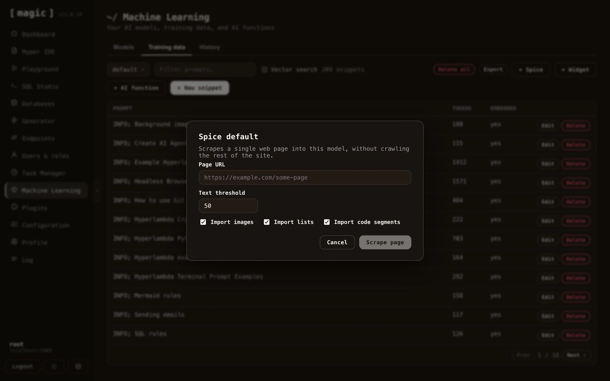
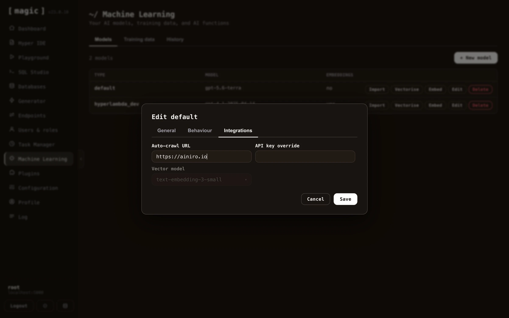

To crawl and scrape your website, create a model, then click the _"Import"_ button on your model, and provide it with your website's URL.

You can upload training data in a wide variety of formats. However, most interestingly for most is that you can simply point Magic at your website, and it will crawl your website, and scrape it for training data that you can later consume using RAG.

The way the crawler works, is by first checking if your website has a sitemap file. If your site has a sitemap, it will retrieve all pages referenced in your sitemap file(s). Once it has retrieved an HTML document, it will scrape each individual page, transform it into Markdown, apply some intelligence related to chopping pages up into multiple training snippets - For then to finally store these as training snippets in your RAG database.

This process resembles the process Google and other search engines are following as they crawl your site, and one of the bonus features of scraping your website, is that you get to some extent see how search engines see your website. Hence, it is also a somewhat valuable tool to SEO quality assure your site. Magic's crawler explicitly identifies as a crawler, and obeys all the standard crawler rules from
your robots.txt file.

## Spicing

The spice feature in Magic allows you to scrape a single URL. This provides you with more control, since you can scrape individual pages, and add individual pages to a model. This might be useful if you've got additional information you want to put into the same model, such as Wikipedia pages, individual articles, etc. To spice a model choose the _"Training data"_ tab in Machine Learning, choose your model, and click the _"Spice"_ button.

## Periodically re-crawl site

You can configure Magic such that it periodically re-crawls your site. This is done by providing _"Website"_ value in your model's configuration. By default Magic contains a scheduled task that is executed once every 24 hours. This task will re-crawl all models you've configured with a website property.

When re-crawling Magic will update any existing pages that were changed, and add new pages it finds. When it is done crawling your site it will automatically vectorize your model.
