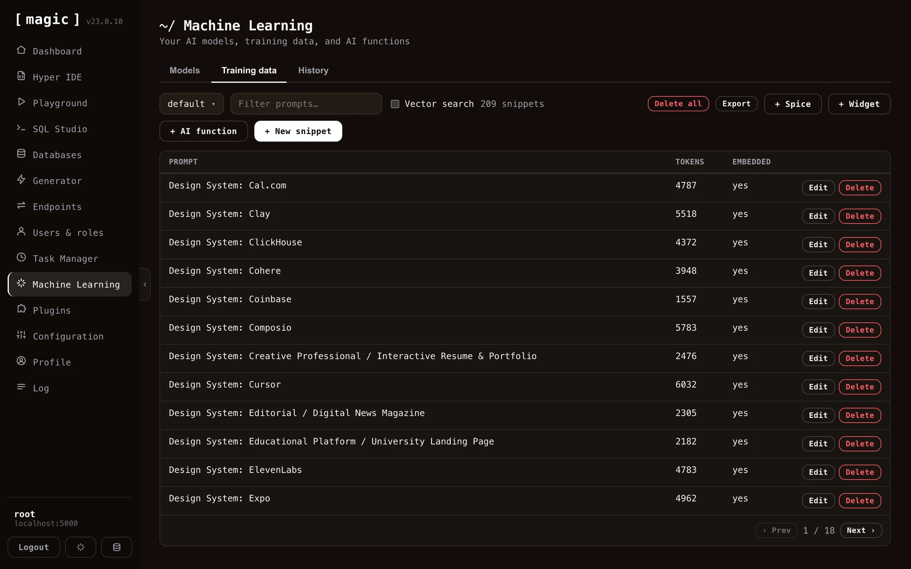
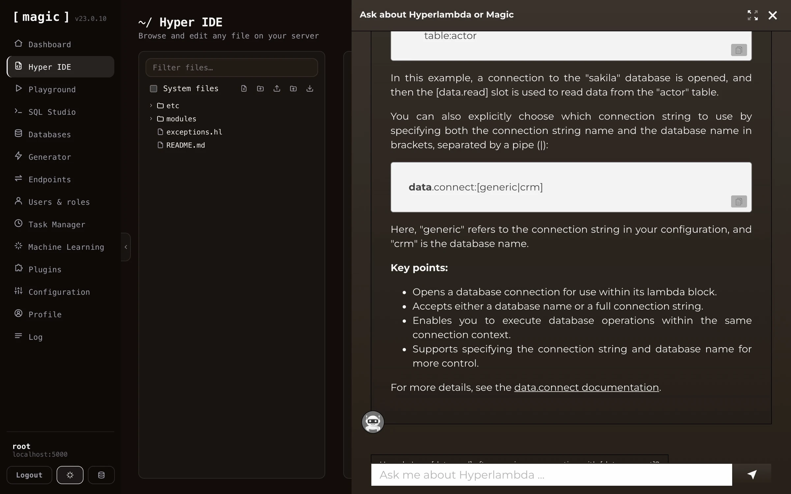
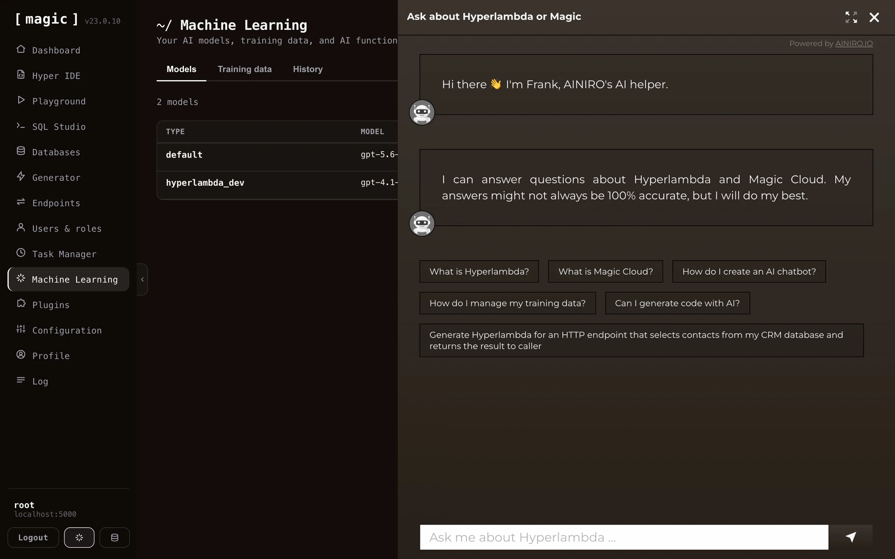

Magic's Machine Learning component allows you to create your own AI based machine learning model, either by crawling your website and scraping it for data, or by manually uploading files, resulting in a private and custom _"machine learning model"_. Machine learning in Magic is built upon OpenAI's API and is similar to ChatGPT, and under the hood it's using RAG and VSS towards your own database to extract context as it's answering questions using OpenAI.

Magic contains a lot of additional services, such as the ability to monitor or supervise usage, storing questions and answers into your database, and use these to review and improve your model's accuracy over time. You can also use historical requests for business intelligence, or lead generation. In addition it ties into Magic's AI Agent abilities, allowing you to integrate AI functions triggering AI workflows from instructions provided by the user.

You can crawl and scrape your website for training data, or upload your own files in a wide variety of formats, such as XML, JSON, YAML, CSV, or PDF. Magic uses RAG/VSS to power your model, which eliminates AI hallucinations, resulting in higher accuracy, and is also significantly less expensive.

## In this section

* [Crawling Your Website](/dashboard/machine-learning/crawling/): To crawl and scrape your website, create a model, then click the "Import" button on your model, and provide it with your website's URL.
* [Models and Configuration](/dashboard/machine-learning/models/): A "model" is a collection of training snippets.
* [Training Snippets](/dashboard/machine-learning/training-snippets/): Magic uses RAG for your machine learning model, which we recommend for 99% of our clients.
* [AI Functions](/dashboard/machine-learning/ai-functions/): This is a subject on its own, but basically a machine learning model has the ability to execute AI functions.
* [Memory and History](/dashboard/machine-learning/memory-and-history/): A training snippet is just a prompt and a completion, which makes it a good place for an AI agent to keep what it learns.

## Use cases

* Expert law system, answering legal questions for your clients
* Medical expert advice system based upon AI and machine learning, giving you help when diagnosing patients and clients
* Support chatbot for your company, giving your clients support for whatever questions they might have
* Automated sales expert systems, converting leads on your website into paying clients
* Cognitive assistants, helping your employees with some specific task at hand
* AI Agents serving as AI assistants performing tasks for you according to your instructions

The advantage of creating your own Machine Learning model is that you can create a private and custom AI chatbot. This can become a much _"sharper"_ intelligence than the publicly available ChatGPT, with knowledge about your particular problem domain, problems ChatGPT is not able to correctly provide answers to.

To understand what I mean here go to [ChatGPT](https://chat.openai.com) and ask it about your company. Chances are that ChatGPT has no idea how to answer your questions correctly. If you scrape your company's website, and/or upload your own training data, you could create a _"custom version of ChatGPT"_, that is able to answer support requests, and/or convince leads and potential clients to become
paying customers, etc. This is of course _impossible_ with the general ChatGPT implementation, but can sometimes be created in some few minutes using Magic Cloud.

This is one of the primary services [AINIRO.IO](https://ainiro.io) is providing, and we have a lot of experience with building high quality AI chatbots. If you want us to create you a chatbot, you can [create a demo chatbot on our website](https://ainiro.io), or [contact us here](https://ainiro.io/contact-us).

## A Machine Learning platform

Magic's machine learning component is actually horizontally implemented into almost every single component in Magic. Need to use AI from [SQL Studio](/dashboard/sql-studio/), no problem, it's an integrated feature. The same is true for [Hyper IDE](/dashboard/hyper-ide/),
and even help is implemented using OpenAI and ChatGPT. If you need help with some [Hyperlambda](/hyperlambda/) code, just mark it in Hyper IDE and click F1, which will use AI to explain what the code does.

You can also use OpenAI to generate code for you. Both Hyper IDE and SQL Studio have a little textbox at the bottom that says _"Where the machine creates the code."_ If you add some piece of instruction here, Magic will invoke OpenAI with your prompt and generate code according to your instructions.

### Magic's integrated support chatbot

In addition, Magic integrates a support chatbot directly into its dashboard. This provides you with integrated help directly from the dashboard. Click the AI chatbot button at the bottom of the navigation sidebar to access this chatbot.


