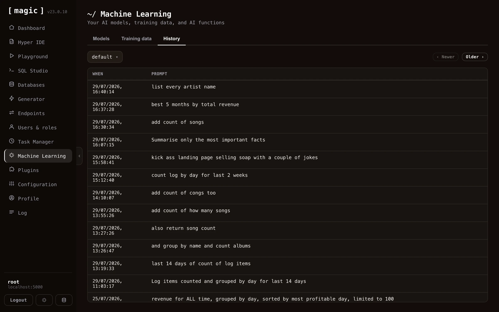

A training snippet is just a prompt and a completion, which makes it a good place for an AI agent to keep what it learns. Connected over [MCP](/tutorials/how-to-connect-the-mcp-server/), or working inside [Chat Ops](/dashboard/chat-ops/), an agent has four functions for treating your training snippets as its _memory_.

* **create-memory** - saves a memory, and makes it searchable straight away. It returns the memory's `id`.
* **search-memory** - finds the best matches for a question, best first, each with its `id`, prompt, completion, URI and meta.
* **update-memory** - changes a memory by `id`, and vectorises it again when what it is found by has changed.
* **delete-memory** - deletes a memory by `id`.

A memory has a **prompt**, which is a single line saying what the memory is about and is what it is found by, a **completion**, which is the content and is stored exactly as given, an optional **uri** for the URL or reference it belongs to, and an optional **meta** label for its kind. They live in the `default` type unless you name another one - the same type your Chat Ops assistant uses, which keeps memories apart from the models that answer your chatbot's visitors. Naming a new type creates it, as a keyword and meaning collection that only root can use. Saving as `meta: FACT ==> some-name` marks a fact, and rows labelled `WORKFLOW ==> name` are the [workflows](/workflows/) saved in the same type, so leave those alone. Snippets that declare functions and widgets are never returned as memories.

Searching combines the two kinds of retrieval described above. Keyword (BM25) matching finds exact names, URLs and identifiers, and search by meaning finds paraphrases, and the two rankings are fused into one. A type set to keyword only is searched by keyword alone, and needs no OpenAI key at all. Everything else costs one OpenAI embedding, spent when a memory is saved or changed and when a search is made. Because the text of a memory is sent to be embedded, never save secrets as memories.

Hyperlambda is a good thing to remember. An agent that has written a working piece of Hyperlambda for an endpoint can save it with the endpoint's URL as the `uri`, and next time search for it by describing the task - sending the recalled code to the endpoint again instead of generating it from scratch. Anything the endpoint does not permit is still refused, because the endpoint checks every call against the caller's allowed functions each time. The same four functions work for notes, decisions, preferences, API quirks and other code, and a memory is never added to your Chat Ops assistant's context by itself - that only happens if you turn on embeddings for the `default` type.

Your connected agent can read the `persist-memory` guide, available through the MCP server's `list-guides` and `read-guide` tools, for how it should use memories.

## History tab

Once you've created a machine learning model in Magic, you can turn on _"supervised"_. This implies that Magic will store each question and answers it's given. This data allows you to review and improve how your model performs over time.

The _"supervised"_ feature also allows you to _"monitor"_ your machine learning model, to verify it is functioning optimally, allowing you to correct it where it fails and provide the correct answer - For then to use it as RAG by creating new training snippets based upon existing questions/answers.

You can easily turn on and off machine learning supervision by editing the configuration for your model.

