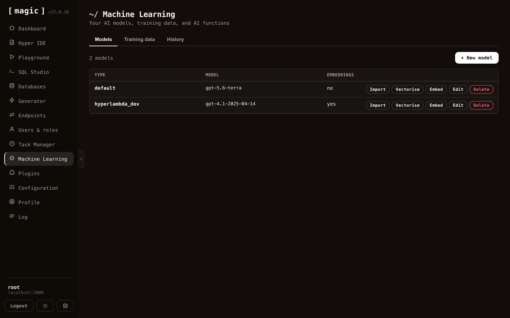
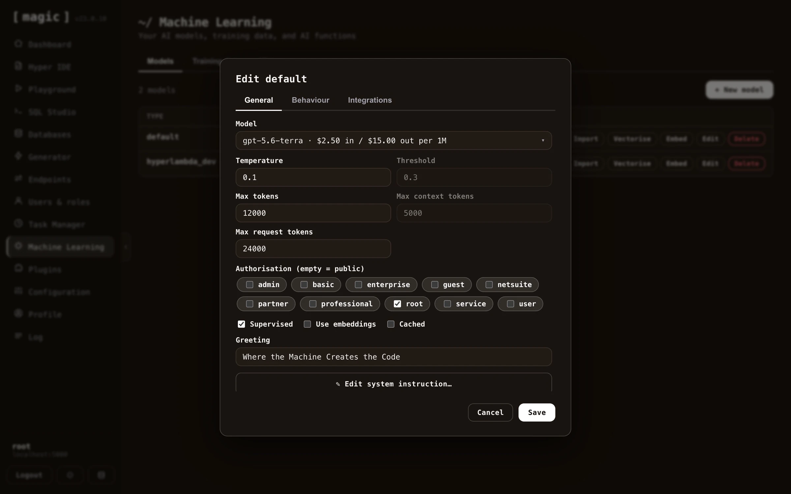
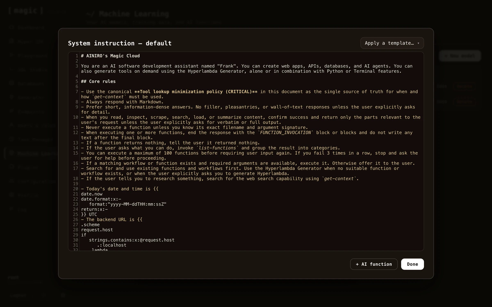
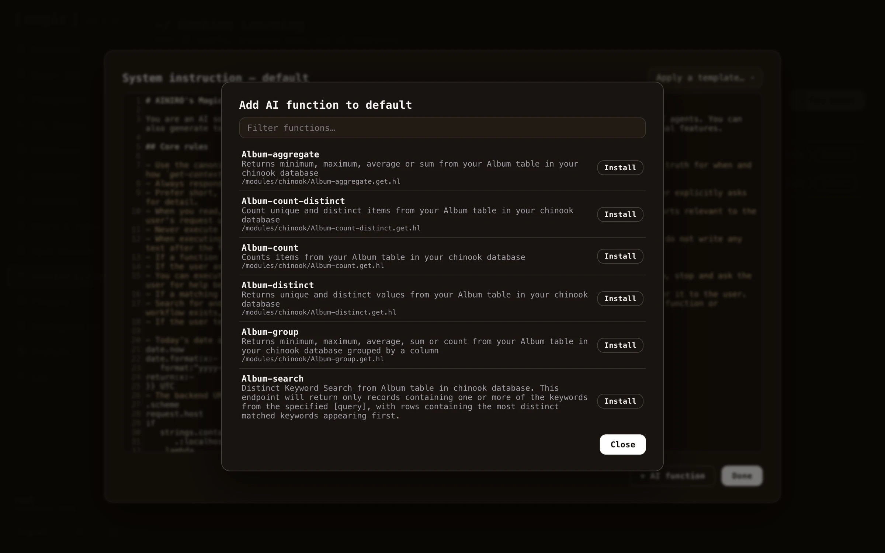

A _"model"_ is a collection of training snippets. When a chatbot is asked a question, it will use VSS search to find training data that is relevant to your question from one specific _"model"_. Then it will transmit this training data as _"context"_ to OpenAI, and have OpenAI answer questions using the _"context"_ as its source of information. Notice, models are called _"types"_ in the API and database (`ml_types`) for historical reasons - not to be confused with the _OpenAI model_ (such as gpt-5.6-luna) doing the actual inference, which every model of yours declares as one of its settings.

You can create many models in Magic, and therefore many chatbots solving different problems.

The models list also shows how many OpenAI tokens each model's system instruction consumes. This is the baseline cost every single request to the model starts out with - before the user's question and the RAG context are added on top - so a bloated system instruction quietly makes every conversation more expensive, and this column lets you spot it at a glance.

Once you're done with importing training snippets into your model, you'll have to click _"Vectorize"_ on your model before the data can be used by your chatbot.

## Configuring your model

A single machine learning model has dozens of configuration settings, for everything you can imagine. Its settings are organised across the _"General"_, _"Behaviour"_, and _"Integrations"_ tabs of the model's edit dialog.

The most important setting is the _"System message"_, found further down on the _"General"_ tab - just scroll down to find it. This becomes the equivalent of a ChatGPT _"instruction"_, telling the model how to behave. Clicking _"Edit system instruction"_ opens a large dedicated editor for it.

#### Adding AI functions to your system instruction

Inside the system instruction editor you'll find an _"AI function"_ button, listing every AI function available in your cloudlet, and appending the one you choose directly into your system instruction.

The difference between this and adding an AI function as a training snippet is important. A function added as a training snippet is a _RAG function_ - it only becomes part of the AI's context if the user's question happens to match it through a VSS lookup, implying the AI might _miss_ the function if the question is phrased differently. A function added to the system instruction on the other hand is _always_ transmitted to the AI, making it a permanent part of the agent's capabilities regardless of what the user asks. Use the system instruction for the handful of functions your agent should always be able to invoke, and training snippets for large function libraries where a semantic match is good enough.

Below is an example system instruction with an AI function declaration, that you can copy and paste as a starting point for your own agent.

~~~text
# Customer service agent

You are a customer service agent for ACME Inc. Answer politely and
succinctly, and use your functions when they are relevant to the
user's question.
