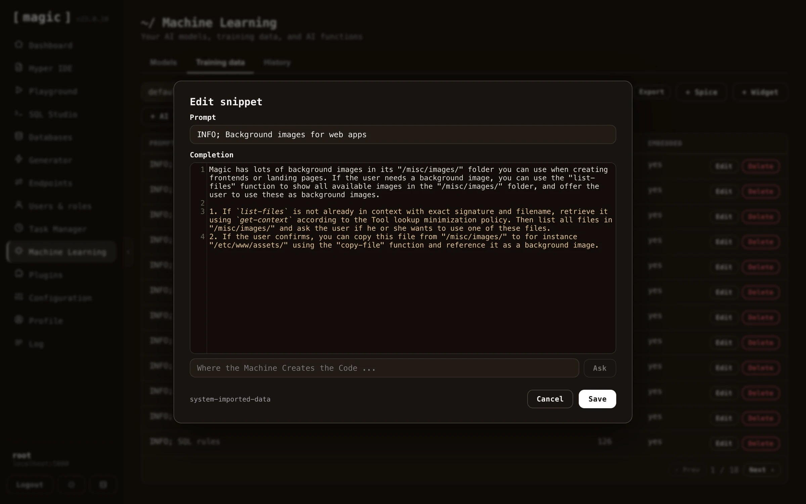
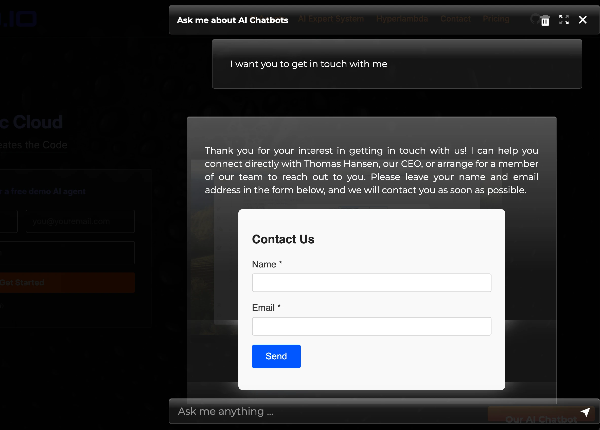

Magic uses RAG for your machine learning model, which we recommend for 99% of our clients. RAG is much less expensive, and most of the time also much more accurate. Each model has a _"Retrieval"_ setting deciding how training snippets are found for a question, with three choices:

* **Semantic (embeddings)** — the default. Uses OpenAI's embeddings API to create embeddings for your training snippets and for each question, matching by meaning — a paraphrased question finds a snippet sharing none of its words.
* **Keyword (BM25)** — full-text search over your training snippets, built on SQLite's FTS5 index. This mode needs no OpenAI embeddings and no vectorise step at all — snippets are searchable the moment they are imported — and it excels at exact terms such as product names, error messages, and identifiers.
* **Hybrid (mixed)** — runs both searches and fuses their rankings, so paraphrased questions and exact terms each find the right snippet. The model's _"Threshold"_ setting applies as a distance cutoff for the semantic part, and as a relative-to-best-hit cutoff for the keyword part.

Whichever mode you choose, the best matching snippets are passed as _"context data"_ to the model answering the question.

It could be argued that we don't ask OpenAI to answer questions, since we already know the answer - Instead we're using OpenAI to reassemble the answer into a sentence that makes sense according to what questions the model is being asked. This has huge benefits, such as for instance almost completely eliminating AI hallucinations, and allowing ChatGPT to answer questions it's got no idea about how to answer without having to train your own model.

One training snippet is one such atomic piece of information. Typically as we transmit _"context"_ to OpenAI, we will transmit multiple training snippets, and choose the most relevant training snippets as we create this context. This allows Magic to _"freely associate"_, and choose training data from multiple different sources as it is creating your context. A single answer might in theory use data from two PDF files, 5 CSV files, and 3 web pages.

## Managing your training snippets

Training snippets can be automatically created as we scrape your website, upload files, or even manually created. In addition, Magic has plugins allowing to connect to a Shopify account through its API, or a WordPress account, etc to import training data. When we setup a chatbot a lot of the work is actually related to _"washing your training data"_ to further increase the quality of the chatbot. By connecting the chatbot to semantic data using an API instead of scraping, the quality of the data typically increases 10x. However, sometimes you will have to manually edit your training snippets. The process of how to do this is shown below.



Notice, you don't have to wash your training data by hand. The snippet editor has its own _"Where the Machine Creates the Code"_ bar, allowing you to clean, edit, or compress individual snippets after importing - provide an instruction such as _"Remove the navigation links and compress this to its essence"_, and the AI transforms the snippet for you, writing the result straight back into the editor.

The training data tab also lets you work with snippets in bulk. _"Export"_ downloads your snippets as a CSV file - optionally only those matching your current filter - and _"Delete filtered"_ deletes every snippet matching your filter in one go, useful for removing an entire bad import. And once your model is ready, the _"Embed"_ button on the Models tab gives you the script tag for including your chatbot on your website, with themes, colours, position and behaviour you can configure.

## Widgets

The _"Widget"_ button on the training data tab allows you to add _"widgets"_ to your model. A widget is a micro app rendered _inside_ the chat stream itself - such as a form, a booking calendar, or a calculator - implemented as a training snippet that instructs the model to render the widget when relevant. After adding a widget, edit its prompt to describe when the chatbot should show it, and the AI displays the widget in the middle of the conversation when a user's question matches.

Below is an example of a working widget. The user asks the chatbot to get in touch, and the AI renders a contact form in the middle of the conversation - allowing the user to submit his or her name and email address to be contacted by AINIRO, without ever leaving the chat.



## Adding Hyperlambda code to training snippets

A single training snippet can also contain Hyperlambda. If this training snippet scores as the first for some query, only this training snippet will be used, and the Hyperlambda code will be executed before the snippet is sent to OpenAI to answer the user's question. Below is an example of such a training snippet.

**How many questions have you answered lately?**

```
The last 14 days I have answered { {
data.connect:[generic|magic]
   data.scalar:select count(*) from ml_requests
   return:x:-
} } questions from happy users.
```

Notice, the `{` and `}` characters have spaces between them. Remove these in your own Hyperlambda snippets to ensure the Hyperlambda is executed. If the user asks the questions; _"How many questions have you answered"_, the model will match the above training snippet, and the Hyperlambda will be executed. After executing the Hyperlambda, the context will end up resembling the following.

> The last 14 days I have answered 123 questions from happy users.

This will then be transmitted to OpenAI as context data, allowing it to use this to answer your question. This allows your chatbot to work with real time data, and connect itself to any additional data source, to dynamically create context data it sends to OpenAI.
