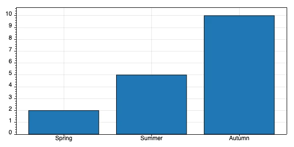
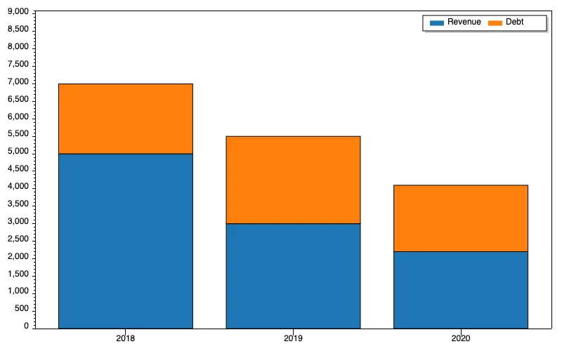
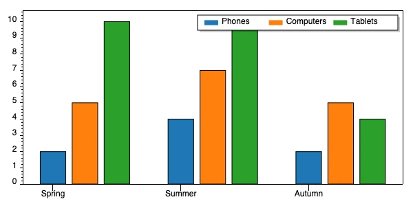

The reference page of [`image.chart`](/reference/slots/image/image.chart/) has its arguments, constraints and declaration.

This slot allows you to dynamically generate charts, and either save these to disc or return them directly as a stream. There exists 3 different types of charts, which are as follows:

* bars
* stacked
* grouped

The primary argument to the slot invocation must be one of the above values, which defines what chart type to generate. Each chart type requires different arguments, but the common arguments are as follows:

* width - Width of chart, between 1 and 8192 pixels
* height - Height of chart, between 1 and 8192 pixels
* filename - Path and name of file of where to save the chart. If not specified the slot will return the chart as a stream.

The slot will always return the chart as a PNG image, and if you provide a **[filename]** the slot will overwrite any existing files automatically with the same path and filename.

## Creating bar charts

This slot requires two additional arguments which are as follows:

* bars - List of numerical values that are the individual bar values, in addition to labels for the x-axis

Below you can find example usage.

```text
image.chart:bars
   filename:/bar-chart.png
   width:600
   height:300
   bars
      Spring:int:2
      Summer:int:5
      Autumn:int:10
```

The above results in the following.



In addition to providing integer values you can also supply decimal, double, or floating point values such as illustrated below.

```text
image.chart:bars
   filename:/bars.png
   width:600
   height:300
   bars
      Spring:decimal:2.5
      Summer:decimal:5.7
      Autumn:decimal:9.8
```

## Creating stacked charts

This slot requires 3 arguments being:

* bars - List of x-axis labels in addition to list of individual values
* legend - Legend for individual parts of your stacked values

An example of usage can be found below.

```text
image.chart:stacked
   filename:/stacked-chart.png
   width:600
   height:300
   bars
      Spring
         .:int:2
         .:int:5
         .:int:10
      Summer
         .:int:4
         .:int:7
         .:int:10
      Autumn
         .:int:2
         .:int:5
         .:int:4
   legend
      .:Phones
      .:Computers
      .:Tablets
```

The above will produce the following chart.



This slot can also accept decimal, float, or double values for its individual values.

## Creating grouped charts

This slot is almost identical to the stacked chart, except it generates a grouped chart instead of a stacked chart. Example usage can be found below.

```text
image.chart:grouped
   filename:/grouped-chart.png
   width:600
   height:300
   bars
      Spring
         .:int:2
         .:int:5
         .:int:10
      Summer
         .:int:4
         .:int:7
         .:int:10
      Autumn
         .:int:2
         .:int:5
         .:int:4
   legend
      .:Phones
      .:Computers
      .:Tablets
```

The above will produce the following chart.



This slot can also accept decimal, float, or double values for its individual values.
