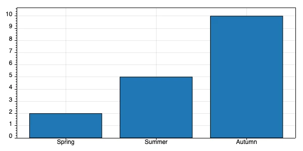
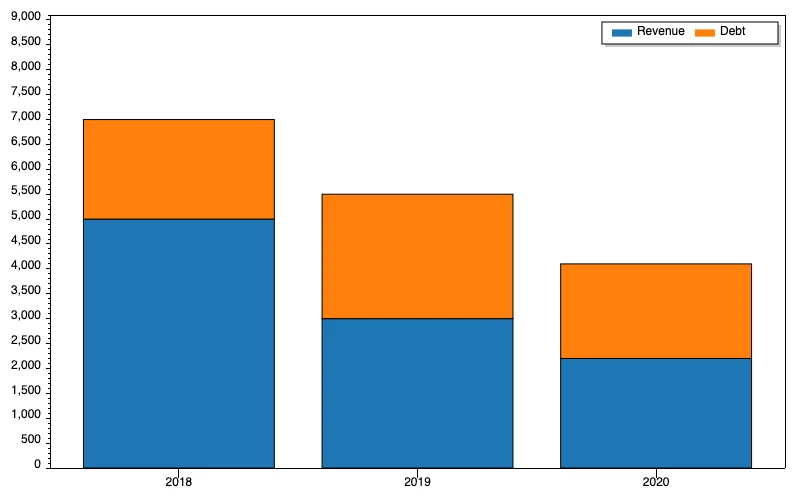
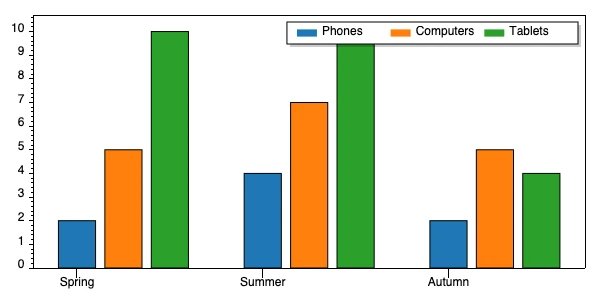

`image.chart` is a slot in the `image` namespace, in Hyperlambda, the language of Magic Cloud. Renders a bar, stacked, or grouped chart from the supplied series data as a PNG image.

* **Value** (`chart-type`), required: Chart type to create, such as bars, stacked, or grouped
* **Returns**: Resolves to the generated chart image bytes

### Arguments

Required arguments come first, then the optional ones in the order they are declared.

| Argument | Type | Required | Description |
|---|---|---|---|
| `[width]` | int | yes | Chart width in pixels. |
| `[height]` | int | yes | Chart height in pixels. |
| `[bars]` | lambda | yes | Chart values keyed by label; grouped and stacked charts use nested numeric values. |
| `[bars]` / _any node name_ | double\|lambda | yes | Bar value or grouped/stacked bar value collection. Can be repeated. |
| `[filename]` | string | no | Optional destination filename. |
| `[legend]` | lambda | no | Legend labels required by grouped and stacked charts. |
| `[legend]` / _unnamed child node_ | string | no | Legend label. Can be repeated. |

### Guide

<!-- guide -->
This slot allows you to dynamically generate charts, and either save these to disc or return them directly as a stream. There exists 3 different types of charts, which are as follows:

* bars
* stacked
* grouped

The primary argument to the slot invocation must be one of the above values, which defines what chart type to generate. Each chart type requires different arguments, but the common arguments are as follows:

* width - Width of chart
* height - Height of chart
* filename - Path and name of file of where to save the chart. If not specified the slot will return the chart as a stream.

The slot will always return the chart as a PNG image, and if you provide a **[filename]** the slot will overwrite any existing files automatically with the same path and filename.

#### Creating bar charts

This slot requires two additional arguments which are as follows:

* bars - List of numerical values that are the individual bar values, in addition to labels for the x-axis

Below you can find example usage.

```text
image.chart:bars
   filename:/bar-chart.png
   width:600
   height:300
   bars
      Spring:int:2
      Summer:int:5
      Autumn:int:10
```

The above results in the following.



In addition to providing integer values you can also supply decimal, double, or floating point values such as illustrated below.

```text
image.chart:bars
   filename:/bars.png
   width:600
   height:300
   bars
      Spring:decimal:2.5
      Summer:decimal:5.7
      Autumn:decimal:9.8
```

#### Creating stacked charts

This slot requires 3 arguments being:

* bars - List of x-axis labels in addition to list of individual values
* legend - Legend for individual parts of your stacked values

An example of usage can be found below.

```text
image.chart:stacked
   filename:/stacked-chart.png
   width:600
   height:300
   bars
      Spring
         .:int:2
         .:int:5
         .:int:10
      Summer
         .:int:4
         .:int:7
         .:int:10
      Autumn
         .:int:2
         .:int:5
         .:int:4
   legend
      .:Phones
      .:Computers
      .:Tablets
```

The above will produce the following chart.



This slot can also accept decimal, float, or double values for its individual values.

#### Creating grouped charts

This slot is almost identical to the stacked chart, except it generates a grouped chart instead of a stacked chart. Example usage can be found below.

```text
image.chart:grouped
   filename:/grouped-chart.png
   width:600
   height:300
   bars
      Spring
         .:int:2
         .:int:5
         .:int:10
      Summer
         .:int:4
         .:int:7
         .:int:10
      Autumn
         .:int:2
         .:int:5
         .:int:4
   legend
      .:Phones
      .:Computers
      .:Tablets
```

The above will produce the following chart.



This slot can also accept decimal, float, or double values for its individual values.
<!-- /guide -->

### JSON declaration

This is the complete declaration of `image.chart`, as the running system describes it. It is also published as [slot.json](slot.json).

<details markdown="1" class="slot-declaration">
<summary>JSON declaration</summary>

```json
{
  "name": "image.chart",
  "description": "Renders a bar, stacked, or grouped chart from the supplied series data as a PNG image",
  "signature": {
    "input": {
      "kind": "chart-type",
      "description": "Chart type to create, such as bars, stacked, or grouped",
      "required": true,
      "mode": "ValueOrExpression"
    },
    "children": {
      "width": {
        "type": "int",
        "description": "Chart width in pixels",
        "required": true,
        "mode": "ValueOrExpression",
        "cardinality": "ExactlyOne",
        "role": "Option",
        "projection": "Value"
      },
      "height": {
        "type": "int",
        "description": "Chart height in pixels",
        "required": true,
        "mode": "ValueOrExpression",
        "cardinality": "ExactlyOne",
        "role": "Option",
        "projection": "Value"
      },
      "filename": {
        "type": "string",
        "kind": "image-file",
        "description": "Optional destination filename",
        "required": false,
        "mode": "ValueOrExpression",
        "cardinality": "ZeroOrOne",
        "role": "Option",
        "projection": "Value"
      },
      "bars": {
        "type": "lambda",
        "description": "Chart values keyed by label; grouped and stacked charts use nested numeric values",
        "required": true,
        "mode": "ValueOrExpression",
        "cardinality": "ExactlyOne",
        "role": "StructuredObject",
        "projection": "StructuredTree",
        "children": {
          "*": {
            "type": "double|lambda",
            "description": "Bar value or grouped/stacked bar value collection",
            "required": true,
            "mode": "ValueOrExpression",
            "cardinality": "OneOrMore",
            "role": "DynamicMap",
            "projection": "StructuredTree"
          }
        }
      },
      "legend": {
        "type": "lambda",
        "description": "Legend labels required by grouped and stacked charts",
        "required": false,
        "mode": "ValueOrExpression",
        "cardinality": "ZeroOrOne",
        "role": "StructuredObject",
        "projection": "Children",
        "children": [
          {
            "type": "string",
            "kind": "chart-legend-label",
            "description": "Legend label",
            "required": false,
            "mode": "ValueOrExpression",
            "cardinality": "ZeroOrMore",
            "role": "Option",
            "projection": "Value"
          }
        ]
      }
    },
    "output": {
      "mode": "Value",
      "kind": "image,binary-content",
      "description": "Resolves to the generated chart image bytes"
    }
  }
}
```

</details>

---

[all `image.*` slots](/reference/slots/image/) | [`image.convert` &rarr;](/reference/slots/image/image.convert/)

